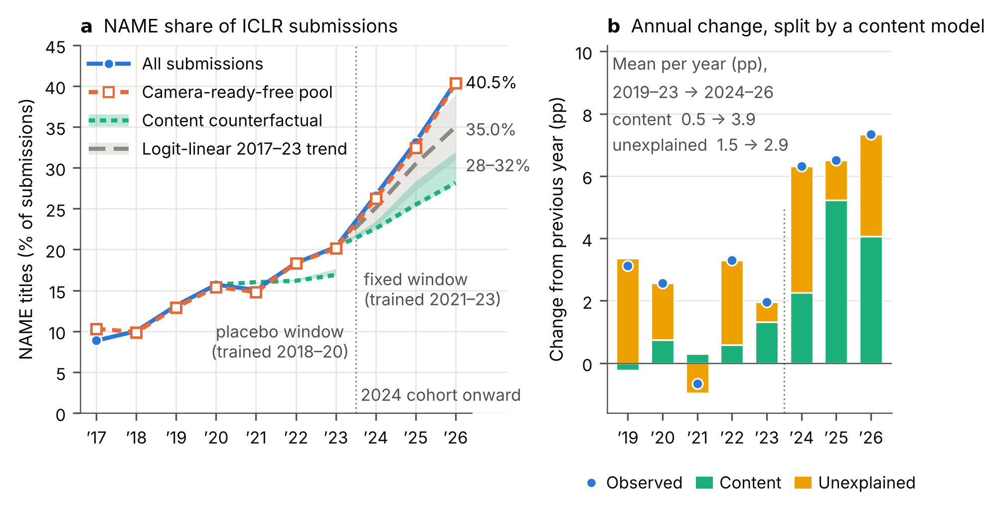
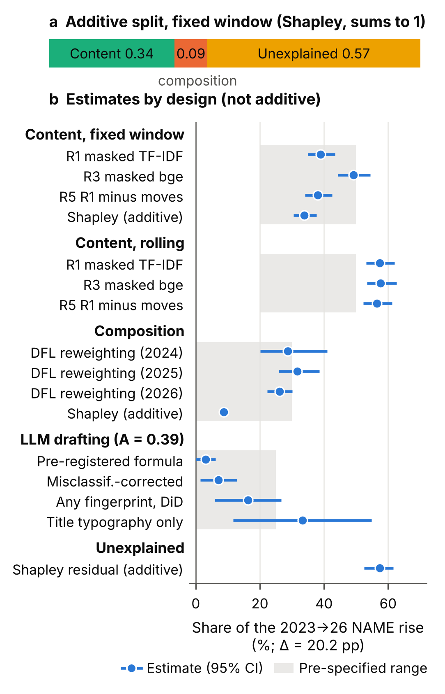
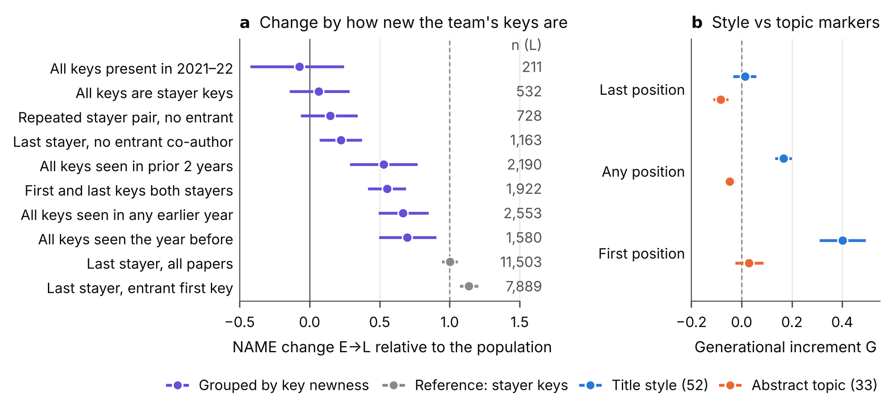
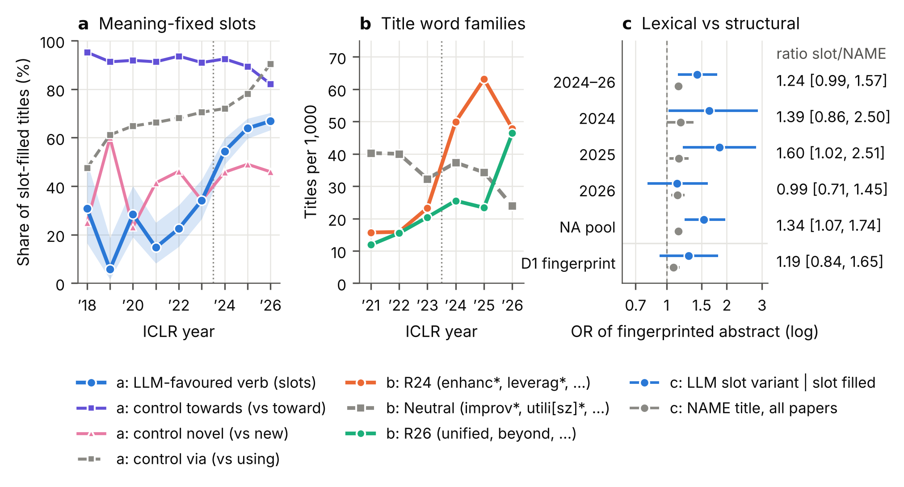
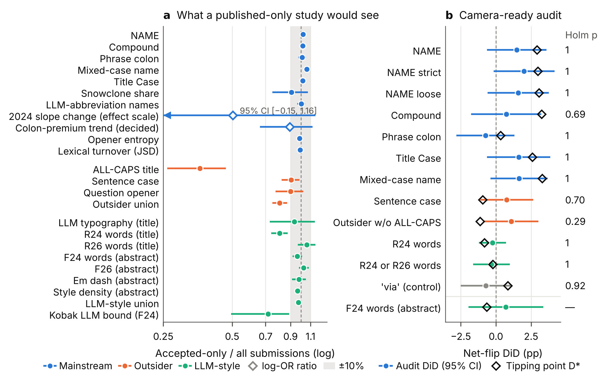
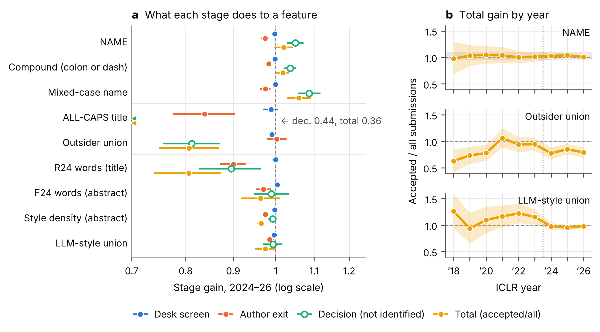

# The Naming Turn: Branding, Fashion and LLM Wording in ICLR Titles, 2017–2026

> **Paper-style report of the ICLR title study.** Generated from the LaTeX paper in `paper/` (compiled PDF: `paper/main.pdf`), which is the reference version. Every number comes from `outputs/` (consolidated ledger: `outputs/SUMMARY.md`); each direction’s full results and audit responses are in `outputs/<direction>/RESULTS.md`. Cross-reference numbers follow the PDF.

## Abstract

At ICLR, machine-learning paper titles have turned into brands. We study 43,482 ICLR submissions from 2017 to 2026, the pre-specified discovery split (about 80%) of the submission record, including rejected, withdrawn and desk-rejected papers. Titles of the form “NAME: subtitle” rose from 8.9% to 40.5% of submissions on a steady logistic path: 2024 and 2025 are consistent with the 2017–23 trend, and 2026 lies 5.5 points above it. Depending on design, 37–65% of the 2023–26 rise tracks name-masked abstract content. Team composition adds little beyond content. Detectable LLM drafting accounts for 7% under the pre-specified fingerprint and 16–33% under broader markers. In the one additive split, 57% remains unexplained. The rise is graded by how new a team’s profile keys are, and incumbent keys, pooled over list positions, take up new title style more slowly than new topics. LLM-favoured verbs were added to meaning-fixed title openers from 2024. Accepted papers carry named titles at the all-submission rate, also after correcting for camera-ready edits. Published papers alone estimate about half the acceleration, imprecisely (ratio 0.50, 95% CI $-0.15$ to 1.16). We report failed predictions from a locked, pilot-informed plan, a reusable camera-ready audit, and cautions for studying co-authored text.

# Introduction

A paper title is the most-read and most compressed piece of scientific text. It is also an act of positioning. In machine learning a recognisable template has spread: a coined name, a colon, and a descriptive subtitle (“NAME: Doing X with Y”). Coined names can make a paper easier to search for, cite and reuse as a component (reviewers and readers do look papers up online; (Rastogi et al. 2022)). They also make a paper look like a product. This study asks how far that template spread at one of the field’s main venues, who carried it, how title wording changed in the LLM era, and whether review decisions select for it.

That colon and acronym titles have become more common is known (Lewison and Hartley 2005; Nelson 2018; Barnett and Doubleday 2020; Mandyam Rangarajan and Krishnan 2026). The rise itself is not our contribution. Our contribution is to observe every decision outcome and to decompose who and what carries the rise. Three features of the setting make this possible and hard at the same time. First, the ICLR record keeps rejected, withdrawn and desk-rejected papers: they are 30,322 of the 43,482 submissions in our discovery split. So we can measure fashion where it is born and not only where it survives. Second, the export is a post-decision snapshot. Accepted papers may carry camera-ready titles, so any comparison of accepted and rejected titles mixes selection with editing. Third, our period spans the arrival of LLM writing tools. Those tools are also the field’s dominant research topic, so style and content move together.

We address four questions, each set out in a locked analysis plan with falsifiable predictions:

- **Q1 (the naming turn).** Did “NAME: subtitle” titles accelerate, and how much of the rise do paper content, team composition and detectable LLM drafting account for?

- **Q2 (carriers).** Did the change happen within incumbent declared profile keys (communal change) or arrive with new keys (generational change)?

- **Q3 (LLM-era wording).** Did LLM-favoured wording rise in title slots where the meaning is held fixed, and is its association with LLM fingerprints lexical or structural?

- **Q4 (review and published-only bias).** How do title-feature shares change across desk rejection, author withdrawal and the decision, and how biased is a study of published papers alone?

The short answers are as follows. At ICLR, titles turned into brands on a steady logistic path; only 2026 lies clearly above the 2017–23 trend. The rise is just as visible in camera-ready-free text, and present outside LLM topics. Depending on design, about half of the recent rise tracks what papers are about. The style rides in with new projects and newcomer-containing teams. LLM-era wording shows a lexical signature in title openers; abstract LLM fingerprints go with both the verb choice and branding, and the lexical association is not detectably larger. Selection at review is neutral for named titles. A published-only view reproduces their share but may miss part of their acceleration.

#### Contributions.

1.  **An all-outcome design with validated measurement.** We use every decision class (accepted, rejected, withdrawn, desk-rejected) in the ${\sim}80\%$ discovery split of ten years of ICLR submissions. Title-structure detectors are validated against two blind LLM annotation passes with adjudication (NAME precision 97.8%, recall 97.3%), and abstract LLM fingerprints have false-positive rates measured in pre-ChatGPT years.

2.  **A camera-ready audit for post-decision snapshots.** We compare stored titles with pre-decision arXiv v1 versions, use a tipping-point criterion and gate every acceptance association with a Holm-controlled rule. The method can be reused for any corpus that stores only final versions, provided independently timestamped pre-decision versions exist for both accepted and non-accepted papers.

3.  **Findings on research fashion**: the shape and decomposition of the naming turn (§4.1), its carriers (§4.2), LLM-era wording in meaning-fixed slots (§4.3), and review selection and published-only bias (§4.4).

4.  **Methodological cautions.** (i) A co-authored text is a *shared outcome*, so key-level “within-incumbent” shares are not diagnostic without a generational null. (ii) Conditioning on slot filling induces collider bias. (iii) Year-level inference with ten annual cohorts is much weaker than paper-level inference suggests.

5.  **A hypothesis ledger and a frozen confirmatory protocol.** We report failed and unidentified predictions of a pilot-informed plan (§5, Appendix A), and a hash-frozen set of twelve confirmatory tests for a held-out split that has not been opened (Appendix G).

# Related work

#### Titles as an object of study.

Title scientometrics relates title form to attention and impact in *published* papers. Titles have grown longer and more often compound across disciplines (Lewison and Hartley 2005; Milojević 2017; Jiang and Hyland 2023). Colon use in computer-science titles rose slowly, from about 10% in the late 1970s to just over 20% by 2018 (Nelson 2018); Anthony (2001) gives a pre-deep-learning baseline for computer-science titles. Associations between title form and citations are small, field-dependent and largely absorbed by venue. Short titles lose most of their advantage once the journal is controlled (Letchford, Moat, and Preis 2015). Colons help in some fields and not in others (Buter and Raan 2011; Hudson 2016; Hartley 2007; Donovan 2025). Question titles have become more common (Ball 2009) and attract more downloads but fewer citations (Jamali and Nikzad 2011). Twin-paper matching on DBLP gives the only causal-style estimate for computer science: a modest colon effect on citations (Sato, Yamada, and Kashima 2022). Two lessons shape our design. Authors choose title style partly on their private view of the paper, which confounds naive outcome comparisons (Heard, Cull, and White 2023). And almost every study conditions on publication. Outside ML, the only study linking title structure to editorial decisions covers one ecology journal (Fox and Burns 2015). Within ML, evidence is limited to an arXiv-proxy causal estimate for buzzy title words (Veitch, Sridhar, and Blei 2020), a title-length ablation in PeerRead (Kang et al. 2018), and a topic-level null for a title-hype lexicon at ICLR (Xu et al. 2026).

Acronyms are the closest precedent for branded titles. Their use in titles grew across science while most are rarely reused (Barnett and Doubleday 2020); named trial acronyms tripled outside cardiology while their quality fell (Pottegård et al. 2014); acronym density in NeurIPS titles rose roughly tenfold since 1987 (Mandyam Rangarajan and Krishnan 2026). Other ML title work counts terms as topic proxies (Mohammad 2019, 2020), classifies stance (Beese et al. 2023), generates titles (Chen and Eger 2023), or traces snowclones (Pullum 2004) such as “all you need” (Alyakin 2025). Wording itself affects how messages spread when topic and author are held fixed (Tan, Lee, and Pang 2014). Promotional language has risen in abstracts and grant texts (Vinkers, Tijdink, and Otte 2015; Millar, Batalo, and Budgell 2022) and is associated with grant-funding success (Peng et al. 2024). Within ML, misuse of language such as suggestive definitions and overloaded terms has been criticised as a troubling trend in scholarship (Lipton and Steinhardt 2018).

#### Research fashion and diffusion.

Styles diffuse by imitation and decline through differentiation (Simmel 1904/1957). Technical fashions follow lifecycles supplied by fashion setters and must look rational and progressive (Abrahamson 1991, 1996; Abrahamson and Fairchild 1999). Diffusion follows an S-shaped path of innovation and imitation (Bass 1969), and informational cascades can produce fads without any change in underlying value (Bikhchandani, Hirshleifer, and Welch 1992). Tastes can change through internal dynamics alone (Lieberson 2000), against a neutral-drift baseline (Bentley, Hahn, and Shennan 2004), and faster rises bring faster abandonment (Berger and Le Mens 2009). In science, bandwagons form around doable problems and transportable packages (Fujimura 1988), and peer-recognition incentives can produce research cycles (Bramoullé and Saint-Paul 2010). Computational histories of NLP trace topic epochs and paradigm shifts (Hall, Jurafsky, and Manning 2008; Anderson, McFarland, and Jurafsky 2012; Pramanick et al. 2023; Gururaja et al. 2023), and the rhetorical framing of a topic predicts its rise or fall (Prabhakaran et al. 2016). At ICLR, the subfield landscape has been mapped from submissions (González-Márquez and Kobak 2024), and emerging topics show higher topic-level acceptance (Xu et al. 2026). Half of the 2023 first authors of LLM papers were new to LLM research (Movva et al. 2024). Sociolinguistics distinguishes *communal* change, in which the same speakers adopt a new form, from *generational* change, in which new cohorts replace old ones. In online communities, users move from an innovative to a conservative phase (Danescu-Niculescu-Mizil et al. 2013), and the fate of an innovation depends on its dissemination (Altmann, Pierrehumbert, and Motter 2011; Stewart and Eisenstein 2018; Del Tredici and Fernández 2018).

#### LLM-era writing.

LLM-modified text spread quickly after ChatGPT: distributional estimates find it in peer reviews (Liang et al. 2024) and computer-science papers (Liang et al. 2025), and excess-vocabulary lower bounds find it in biomedical abstracts (Kobak et al. 2025). LLM vocabulary has shifted computer-science abstract style (Geng and Trotta 2024), and flagged marker words such as “delve” recede once publicised while others keep rising (Geng and Trotta 2025); why models over-use particular words is itself studied (Juzek and Ward 2025). Writing with LLMs reduces content diversity in controlled studies (Padmakumar and He 2024; Sourati et al. 2026). Evidence on titles is thin: LLM-favoured verbs rising in Scopus titles (Comas-Forgas, Koulouris, and Kouis 2025), “via” and “beyond” exceeding trend in arXiv titles (Geng, Dong, and Poibeau 2026), and small regeneration studies in which ChatGPT titles are longer and always use a colon (Sebo, Nie, and Wang 2026) and are preferred by readers (Sebo, Nie, and Wang 2025). Because LLMs are both the dominant research topic and a writing tool in our period, style must be separated from content. Excess-word methods cannot do this on ten-word strings, which motivates our meaning-fixed slot design.

#### Peer review and text.

Acceptance has been predicted from submission text since PeerRead (Kang et al. 2018). ICLR’s open process has supported studies of institutional prestige, anonymity and arXiv visibility (Tran et al. 2020; Bharadhwaj et al. 2020; Sun, Barry Danfa, and Teplitskiy 2022; Elazar et al. 2024); more than a third of reviewers search for papers online (Rastogi et al. 2022). Resubmissions face a reviewer bias (Stelmakh et al. 2021), and AI-assisted reviewing (Latona et al. 2024) and an LLM review-feedback experiment (Thakkar et al. 2025) changed the ICLR review process in our post-LLM years. When text is both treatment and confounder, adjustment needs text-based confounder control (Keith, Jensen, and O’Connor 2020; Pryzant et al. 2021; Feder et al. 2022; Egami et al. 2022); our name-masked content counterfactual is a descriptive version of that idea. Prior studies analyse decided papers. Withdrawn and desk-rejected submissions (9,954 and 883 in our discovery split) are usually dropped. We treat them as outcomes and quantify what a published-only view of title fashion misses.

# Data and measurement

## Corpus and pools

The data are the ICLR discovery export: 43,516 submissions from 2017 to 2026, with 219,719 declared author-list positions. Dropping one empty title, 17 placeholder titles and 16 abstracts under 20 words leaves the universe $U$ of 43,482 submissions. The export is the pre-specified discovery split, about 80% of all submissions; a held-out confirmation split (about 20%) has not been requested (§3.6). The split keeps linked submission families together and keeps one submission per family, and its mechanism is not recorded. Table 1 gives counts by year; yearly counts are therefore about four fifths of public ICLR totals.

The pools are: accepted (ACC); rejected (REJ); withdrawn (WD), with 349 post-decision withdrawals in 2026 flagged separately; and desk-rejected (DR). The *camera-ready-free pool* (NA $=$ REJ $\cup$ WD $\cup$ DR; 30,322 papers) carries pre-decision text, free of camera-ready edits though possibly revised during the rebuttal period, and every key result is repeated in it. Topics are KMeans clusters ($k=100$) of MiniLM abstract embeddings, replicated with bge-small. A paper is LLM-topic if it matches an LLM regex or sits in a cluster where most papers do.

#### Author information.

Authors enter only as *declared profile keys*: exact recorded IDs, which are not verified persons. A key is a *stayer* if it appears in both the early window (E $=$ 2022–23) and the late window (L $=$ 2025–26), and an *entrant* if it appears only in L. “First” and “last list position” are partition labels; they say nothing about seniority. Because the held-out split is missing, a key whose earlier papers sit there appears as an entrant; under a further random removal of 10–30% of papers the carrier ratios move by less than 0.01, and under a family-structured removal by up to $-0.05$ (Appendix B).

| Year  |    $U$ |    ACC |    REJ |    WD |  DR | NAME | NAME$_{\text{NA}}$ | Cmp. |
|:------|-------:|-------:|-------:|------:|----:|-----:|-------------------:|-----:|
| 2017  |    384 |    149 |    194 |     0 |   0 |  8.9 |               10.3 | 19.3 |
| 2018  |    769 |    263 |    378 |    57 |   0 | 10.0 |                9.9 | 22.9 |
| 2019  |  1,248 |    412 |    713 |   123 |   0 | 13.1 |               12.9 | 25.9 |
| 2020  |  2,070 |    558 |  1,215 |   290 |   7 | 15.7 |               15.4 | 26.7 |
| 2021  |  2,360 |    678 |  1,341 |   327 |  14 | 15.0 |               14.8 | 28.2 |
| 2022  |  2,649 |    875 |  1,156 |   599 |  19 | 18.3 |               18.3 | 31.7 |
| 2023  |  3,872 |  1,256 |  1,717 |   883 |  16 | 20.3 |               20.1 | 32.6 |
| 2024  |  5,765 |  1,778 |  2,657 | 1,293 |  37 | 26.6 |               26.3 | 41.1 |
| 2025  |  8,953 |  2,904 |  3,674 | 2,322 |  53 | 33.1 |               32.5 | 49.8 |
| 2026  | 15,412 |  4,175 |  6,440 | 4,060 | 737 | 40.5 |               40.3 | 59.9 |
| Total | 43,482 | 13,048 | 19,485 | 9,954 | 883 |      |                    |      |

Corpus by year: the discovery split (${\sim}80\%$ of all submissions). NAME and compound (Cmp.) shares in %, for all submissions and for the camera-ready-free pool (NA). Sources: `core/universe_counts.csv`, `features/fig_name_share_by_year.csv`. A further 112 rows of 2017–18 have no recorded decision.

## Measures

Table 2 defines every measure and the short names used in the text; Appendix C gives example titles and the detector rules.

- **NAME (primary).** A title whose lead, before a colon or spaced dash, names one specific artefact: a single non-genre token (“QANet: …”, “mixup: …”), a two-token lead with an inner capital or digit, or a phrase ending in a parenthesised acronym. NAME counts any name-led title, including leads that name a pre-existing technique; it measures name-led titles, not self-branding as such. **Compound** titles have any colon or spaced dash.

- **Meaning-fixed slots** (§4.3). The first word of the title, or of the subtitle after “NAME:”, is drawn from a frozen set of near-synonym pairs. Each pair contrasts an LLM-favoured variant with a neutral one: *enhancing/boosting/…* vs *improving*; *unveiling/uncovering/…* vs *understanding/analysing/…*; *leveraging/harnessing/…* vs *exploiting/utilising*; *comprehensive* vs *systematic/extensive/large-scale*. Control pairs chosen as unlikely to carry an LLM preference (towards/toward, novel/new, via/using) give a placebo. Via/using, 76% of control titles, itself drifts and is reported as LLM-favoured in arXiv titles (Geng, Dong, and Poibeau 2026), so it is a control at the pre-specified 2024 break only.

| Name (symbol)                         | Definition                                                                                                                 |
|:--------------------------------------|:---------------------------------------------------------------------------------------------------------------------------|
| NAME, compound Name-led title         | ; any colon or spaced dash                                                                                                 |
| NA pool                               | Rejected, withdrawn and desk-rejected papers (camera-ready-free)                                                           |
| LLM title words (R24)                 | *enhanc\*, leverag\*, unveil\*, unleash\*, harness\*, empower\*, elevat\*, boost\**                                        |
| LLM title words (R26)                 | *unified, unifying, beyond, bridging* (chosen after a pilot)                                                               |
| Neutral synonyms (N24)                | *improv\*, utili\[sz\]\*, …*                                                                                               |
| Abstract LLM-word fingerprint (F_any) | Abstract has $\geq 1$ of 21 rare LLM-favoured words (F24), 2026-vintage words or dash compounds (F26), or title typography |
| Strict fingerprint (F_d1)             | $\geq 2$ of the 21 rare words; drives the tool share                                                                       |
| Masked TF-IDF / bge (R1 / R3)         | Content models on name-masked abstracts; R5 $=$ R1 without rhetorical moves                                                |
| Stayer, entrant                       | Key present in E and L; key present only in L                                                                              |
| Stayer ratio ($\rho$)                 | Stayer change / population change, E$\rightarrow$L                                                                         |
| Generational increment ($G$)          | $1 -{}$slope of within-stayer on population change across markers                                                          |
| Stage gain                            | $P(f\mid\text{passed stage})/P(f\mid\text{entered stage})$                                                                 |
| Tipping point ($D^*$)                 | Camera-ready excess that would bring a gain to 1                                                                           |
| DFL, Shapley                          | Reweighting and additive decompositions of the rise                                                                        |

Notation. Descriptive names are used in the text; symbols appear in tables and the appendix.

## Validation

Two blind annotation passes labelled 1,400 stratified titles, including 200 hard cases. Both passes were LLM annotators (Claude subagents with different codebooks and prompts; the outputs record them as different models but do not log model versions), blind to year, outcome and detector output. The 58 disagreements were adjudicated from the title text alone by the PI’s delegate, an LLM agent in the study’s workflow, who also did a 150-item spot check of agreed items; that check is not independent, and there is no human gold standard. Cohen’s $\kappa$ was 0.948–1.000 on all five labels, against a 0.80 target; because both passes come from one model family, their errors may be correlated. Against the adjudicated consensus, the NAME detector has precision 97.8% \[97.5, 98.3\] and recall 97.3% \[96.1, 98.3\], and its precision varies by only 1.2 pp across year blocks. Correcting for misclassification moves the key trend estimate from OR 1.098 to 1.090. Three slot variants failed a sense-precision check ($<0.85$) and were dropped before any slot model was fitted. The abstract fingerprints have pre-ChatGPT (2021–22) false-positive rates of 2.9% (F24) and 3.2% (F26). Their correlation with LLM-polish ratings is weak (Spearman 0.25 for F_any), so all tool-related quantities are model-conditional.

## Abstracts in three roles

1.  **Content anchor.** We predict NAME from *name-masked* abstracts, with the coined name and its variants removed (masked TF-IDF, primary; masked bge; masked TF-IDF without rhetorical-move n-grams). The predictions answer “what NAME share would the content of this year’s papers imply?”. This is a descriptive analogue of text-based confounder adjustment (Keith, Jensen, and O’Connor 2020). Masking leaves the whole-word lead in 0 of 12,928 NAME abstracts under bge and in 22 under TF-IDF.

2.  **LLM fingerprint channel** (Table 2).

3.  **Published-only bias case.** Kobak-style excess-vocabulary lower bounds (Kobak et al. 2025) (the F24 share minus a conservative baseline), computed separately for accepted papers and for all submissions.

## The camera-ready audit

The export stores one version of each paper. For accepted papers that may be the camera-ready version, so the observed decision-stage gain mixes selection with post-decision editing. We bound the editing part with an **arXiv audit** (Appendix D). For a stratified random sample of 2,616 papers (an original audit of 616, of which 600 are from 2023–26 and 16 are accepted 2022 papers used only in a sensitivity specification, plus an enlargement of 2,000) we kept arXiv v1 versions posted before that year’s decision date: **1,311 pre-decision pairs** (803 accepted, 508 rejected). The accepted-minus-rejected difference in net feature flips between v1 and the stored title (a net-flip difference-in-differences) estimates the camera-ready excess, *under the assumption* that non-camera-ready edits occur at the same rate in both arms; we check this by v1 timing. A decision-stage association is identified only if its tipping point $D^*$ lies beyond what the audit allows, and only if it survives Holm across the 18 auditable title features at one-sided $\alpha=0.025$.

## Inference and the analysis plan

- **Plan.** Before locking the plan we ran pilot analyses on these same discovery rows, and several predictions, thresholds and two lexicon choices (*enhancing*, R26) were set from pilot estimates. The plan was then locked, with a hash recorded, before the reported estimation, and is not edited. Discovery verdicts therefore check whether pilot-derived predictions survive the full, audited pipeline; they are not tests of blind predictions. Table 4 lists the pilot value next to each prediction.

- **Confirmatory protocol.** Twelve confirmatory tests (CT1–CT12) for the held-out split are frozen in a hashed bundle (revision 3, SHA-256 `6853685b…`; Appendix G). The hash is recorded internally and has not yet been deposited with a third party; we will deposit it publicly before requesting the held-out data. Their projected power is limited (0.23–0.32 for the slot and register tests at the corrected $\alpha$).

- **Multiplicity.** Holm within each direction’s confirmatory family.

- **Year-level inference.** Cohort-level treatments vary only across ten years, so the primary trend tests use random-effects meta-regression on adjusted year effects ($t(6)$ references) and two-stage bootstraps with simulated year shocks.

- **Adversarial internal review.** Each analysis went through three adversarial review passes (code, identification, reporting) by separate LLM agents with access to code and outputs. Every issue was re-checked, fixed and logged, and two integration passes aligned the analyses.

# Results

## The naming turn and its decomposition

#### Shape.

NAME titles were 8.9% of ICLR submissions in 2017, 20.3% in 2023 and 40.5% in 2026; compound titles rose from 19.3% to 59.9% (Table 1, Figure 1a). On the log-odds scale, on which diffusion is usually judged (Bass 1969), the share has followed a steady logistic path since 2017: the 2017–23 pre-trend is OR 1.125 per year (odds $+12.5\%$ a year), and this trend alone projects 35.0% for 2026. Deviations from it are $+1.5$ pp \[-0.7, 3.8\] in 2024, $+2.7$ pp \[-0.5, 5.9\] in 2025 and $+5.5$ pp \[1.5, 9.5\] in 2026. The year-level log-odds slope change at 2024 is OR 1.096 \[0.990, 1.214\] (one-sided $p=0.035$; Holm 0.071; paper level 1.098 \[1.044, 1.154\]). A constant log-odds slope is already convex on the probability scale, where the slope change is $+2.8$ pp per year \[1.3, 4.4\]; we report this only as a secondary description. The camera-ready-free pool tracks all submissions (40.3% in 2026; year-level slope change 1.121 \[1.019, 1.232\]), so the rise is not a camera-ready artefact. The rise is also present outside LLM topics (19.5% to 36.0% between 2023 and 2026), but there the year-level slope change, 1.108 \[0.986, 1.245\], includes 1. Compound titles show a larger paper-level slope change, 1.231 \[1.176, 1.289\] (Table 5).

#### Timing and the 2026 cohort.

The acceleration is not a dated break. The pre-specified sup-LR scan selects 2023, not 2024, and a 2023 break, a 2024 break, a 2024 kink and a quadratic trend fit about equally well. 2026 is the year of a new desk-rejection regime and has 15,412 of the 43,482 papers. **The acceleration depends on 2026; the carrier, slot and filter results do not** (Table 3). Nothing in this design ties the timing to ChatGPT.

| Result                              | All years                   | Without 2026                |
|:------------------------------------|:----------------------------|:----------------------------|
| NAME slope change, year level (OR)  | 1.096 \[0.990, 1.214\]      | 1.046 \[0.807, 1.355\]      |
| Unexplained-drift acceleration (pp) | $+1.35$ \[0.03, 2.71\]      | $+1.15$ \[-0.63, 2.96\]     |
| Stayer ratio, last position$^a$     | 0.995 \[0.943, 1.050\]      | 1.003 \[0.918, 1.095\]      |
| First $-$ last stayer ratio$^a$     | $-0.470$ \[-0.602, -0.359\] | $-0.474$ \[-0.670, -0.276\] |
| Pooled slot OR at 2024              | 2.18 \[1.41, 3.38\]         | 2.27 \[1.36, 3.80\]         |
| NAME filter gain, accepted/all      | 1.021 \[1.001, 1.041\]      | 1.037 \[1.008, 1.068\]      |

Which results depend on 2026. 95% CIs (90% for the NAME filter gain). Sources: `d1_break`, `d2_carriers`, `d3_register`, `d4_filter` RESULTS.md.

$^a$ Without 2026: E $=$ 2021–22, L $=$ 2024–25. 2026 composition by affiliation or country cannot be measured from the export.

**Figure 1.** **The naming turn.** (a) NAME share of ICLR submissions (discovery split), for all submissions and the camera-ready-free pool, against the logit-linear 2017–23 trend (dashed; band from the year-deviation CIs) and name-masked content counterfactuals (dotted: masked TF-IDF, fixed window; ribbon: range over the three masked representations in the fixed and rolling designs; the placebo window trained on 2018–20 already under-predicts 2021–23). The content counterfactuals (28–32% in 2026) lie below the trend (35.0%). (b) Annual change split into the part predicted by a rolling name-masked content model and the unexplained part. Mean content steps rose from 0.5 to 3.9 pp per year and unexplained steps from 1.5 to 2.9 pp per year (2019–23 $\rightarrow$ 2024–26); the difference in unexplained steps, $+1.35$ pp, has a two-stage year-level 95% CI of \[0.03, 2.71\].

#### Content.

How much of the 2023\$\$26 rise does the content of the papers track? Name-masked content models give 0.39 \[0.35, 0.43\] (masked TF-IDF) and 0.49 \[0.44, 0.54\] (masked bge) in a fixed window trained on 2021–23, and 0.57 \[0.53, 0.62\] and 0.58 \[0.53, 0.63\] in a rolling one-step design. Across specifications (training-year effects, slope recalibration) the share ranges from **0.37 to 0.65** (Table 6). The content counterfactuals reach 28–32% in 2026, below the naive 2017–23 trend (35.0%): part of what the trend “predicts” is not carried by content. The one *additive* split is the fixed-window Shapley decomposition: content 0.34, composition 0.09 and unexplained 0.57 (refit bootstrap \[0.48, 0.67\]) (Figure 2a). The other estimators come from different designs and cannot be summed. The content signal is dominated by LLM-era topic words (*reasoning, generation, benchmark, evaluation*), so “content” includes the move into LLM topics, the channel through which the writing tool also operates.

#### Branding runs ahead of content in new topics.

The pre-specified new-topic placebo fails in every window. In topic clusters whose share grew at least threefold, observed NAME exceeds the content prediction by 15.8 pp against 7.7 pp elsewhere (year-averaged absolute residuals, fixed 2024–26 window), a gap difference of 8.0 pp \[6.8, 9.2\]. The pattern already appears in the pre-LLM placebo window (3.6 pp \[1.0, 6.2\]). Either naming is a property of new artefact-producing topics that bag-of-words content misses, so content shares are understated, or the fashion spreads fastest in hot topics.

#### Composition and detectable LLM drafting.

Reweighting 2024–26 papers to the 2023 distribution of team size $\times$ new-key share $\times$ LLM topic accounts for 0.29, 0.32 and 0.26 of the rise in 2024, 2025 and 2026 (DFL), but only 0.09 net of content (Shapley). Mean declared author-list size rose from 4.56 to 5.67 and the LLM-topic share from 0.106 to 0.482; most of the composition effect is the LLM-topic margin, which overlaps content. NAME rose almost identically among papers with and without the strict fingerprint F_d1 (from 20.3% to 40.1% unflagged, 20.6% to 42.0% flagged); the fingerprint uplift is $+1.6$ pp \[0.0, 3.2\]. Corrected for fingerprint misclassification and assuming the plan’s bound of 39% LLM-drafted 2026 abstracts, detectable drafting accounts for **7.1% \[1.4, 12.9\]** of the rise: a model-conditional estimate, not an upper bound. The broader fingerprint F_any gives 16.3% \[5.9, 26.7\] and a title-typography marker 33.3% \[11.7, 54.8\]. The tool share overlaps content rather than forming a separate slice, and F_d1 fails a positive control (slot OR 1.29 \[0.92, 1.81\], against 1.42 \[1.14, 1.79\] for F_any).

#### What remains.

The Shapley residual (0.57) includes new-topic naming that content models miss, undetected tool use and unmeasured composition; we call it *unexplained drift*, not “fashion”. Its acceleration is not established: unexplained steps rose from 1.51 to 2.87 pp per year, $+1.35$ pp \[0.03, 2.71\] (Holm 0.067), and the year-level CI includes 0 in the camera-ready-free pool ($+1.14$ pp \[-0.10, 2.39\]), in the non-LLM subset ($+0.55$ pp \[-0.90, 1.99\]) and without 2026.

**Figure 2.** **What accounts for the 2023$\rightarrow$<!-- -->26 NAME rise** ($\Delta=20.2$ pp). (a) The one additive split (fixed-window Shapley). (b) Estimates from separate designs, which are *not* additive: name-masked content (fixed and rolling), composition (DFL for each of 2024–26; Shapley), detectable LLM drafting under four estimators at an adoption rate of 0.39, and the Shapley residual. Grey bands: pre-specified predictions. CIs: conditional paper bootstrap ($B=2000$); tool-share CIs propagate the CI of the fingerprint uplift.

## Who carries it

#### The pooled ratio is not diagnostic.

At the last list position, papers carrying a stayer key moved from 18.8% to 37.1% NAME between E and L, almost exactly the population’s 19.4% to 37.8% (stayer ratio $\rho_{\text{last}}=0.995$ \[0.943, 1.050\]). This looks like communal change, but a title is shared by every co-author: in L, 69% of papers with a stayer key at the last position (7,889 of 11,503) have an entrant key at the first position. A purely generational world, in which only papers with an entrant key at the first position changed, combined with the observed co-authorship, gives $\rho_{\text{last}}$ of 0.88–0.93 and $\rho_{\text{any}}$ of 0.78–0.82, above the pre-specified thresholds. The prediction is met, but communal change is **not identified**. Our first caution: key-level within-incumbent shares of co-authored text need a shared-outcome generational null.

#### The rise is graded by team newness

(Figure 3a). Relative to the population change (18.3 pp), papers whose keys are all stayers changed 0.06 \[-0.14, 0.28\] times as much, and papers whose keys were all present in 2021–22 $-0.07$ \[-0.42, 0.24\] times (this fixed-base row has E $=$ 2023 and is a ratio to that window’s 17.5 pp). Last-position stayer keys on papers without an entrant co-author key changed 0.22 \[0.07, 0.37\] times as much, teams whose keys were all seen the year before 0.70 \[0.49, 0.90\], and last-position stayer keys on papers with an entrant first-position key 1.14 \[1.07, 1.20\]. A pre-specified test (H2c) predicted that stayer keys’ change, extrapolated in a key-fixed-effects regression to a zero share of new co-author keys, would be at least half the population change; it is 0.34 \[0.19, 0.48\] times as much, so the prediction fails. H2c is a regression estimate at zero share of new co-authors, whereas the “no entrant co-author” row is a subgroup of L papers without any key first seen in L. Papers whose keys were all stayer keys barely moved, and among the 297 retitled resubmission pairs that survive the export (one submission per family, so pairs are selected on retitling) NAME was not added on net (28 adds, 28 drops; mean 0.000, se 0.025). Whether this lags the content-fixed drift is not established ($-4.8$ pp against topic-adjusted drift, $p=0.057$). The style rides in with new projects and newcomer-containing teams. Groups of keys that did not adopt the style may also be the ones that did not add co-authors, and who chose a title on a mixed team is not identified.

#### First-position newcomer premium.

In L, papers whose first-position key is an entrant carry NAME titles 10.6 pp \[8.5, 12.6\] more often than papers whose first-position key is a stayer; within the same last-position key, with team-size and topic fixed effects, the gap is 4.9 pp \[2.2, 7.6\]. Stayers have at least three years of panel presence, so the contrast mixes cohort with tenure. With a symmetric two-year lookback the premium is absent in 2023 ($-0.2$ pp raw) and appears from 2024 (change to 2025–26: $+4.3$ pp \[0.3, 8.4\]). This is a contrast between position labels, not a role effect.

#### Style versus topic.

For 52 title-style and 33 abstract-topic markers we compute the generational increment $G$. Within-stayer change keeps pace with topic markers ($G_{\text{topic}}=-0.05$ \[-0.07, -0.03\]) but lags style markers ($G_{\text{style}}=0.17$ \[0.13, 0.20\]) (Figure 3b). A shared-outcome null predicts the same ratio for every marker, so a difference between channels cannot come from co-authorship composition. The weighted statistic is dominated by the NAME family (93% of the style weight) and the LLM-topic marker (94.5% of the topic weight), but the contrast survives dropping both (difference 0.19 \[0.13, 0.26\]) and equal marker weights (median per-marker ratio: style 0.84, topic 1.05). The gap sits at the first list position ($G_{\text{style}}=0.40$) and vanishes at the last (0.01). **Incumbent keys track topic shifts fully but style shifts only partly.**

**Figure 3.** **Who carries the NAME rise** (declared profile keys; list position is a label only). (a) NAME change between E $=$ 2022–23 and L $=$ 2025–26 on papers grouped by how new their keys are, as a ratio of the paper-level population change (18.3 pp; 17.5 pp for the fixed-base 2021–22 row, whose early window is 2023; key-cluster bootstrap 95% CIs; right column: L-period papers). The reference row “Last stayer, all papers” is a ratio to the paper-level change, not $\rho_{\text{last}}$. (b) Generational increment $G$ for 52 title-style and 33 abstract-topic markers by list position.

## LLM-era wording in meaning-fixed slots

#### Slots.

Comparing synonyms that compete for the same opening slot holds what the title claims approximately fixed, conditional on a slot being filled. Among 1,922 slot-filled titles (2018–26), the LLM-favoured variant’s share was 0.34 in 2023, 0.54 in 2024 and 0.67 in 2026 (Figure 4a). In the pre-specified model with slot-specific trends, the 2024 level shift is OR 2.18 \[1.41, 3.38\] for the slots and 0.87 \[0.64, 1.18\] for the pooled controls, and the slot-minus-control contrast is 2.55 \[1.53, 4.25\] (Holm $p<0.001$). It holds in the camera-ready-free pool (2.18 \[1.28, 3.70\]) and the non-LLM subset (2.59 \[1.57, 4.28\]). Per 1,000 titles, LLM-variant openers rose from 11.4 (2023) to 30.0 (2024) while neutral variants stayed flat (22.0 to 25.2): level shifts RR 3.91 \[1.84, 8.29\] against 1.17 \[0.70, 1.94\]. In 2024 the new verbs were *added* rather than swapped for their neutral synonyms; substitution appears only in 2025–26.

#### Qualifications.

\(i\) The pooled control null rests on via/using, 76% of control titles and itself LLM-associated (Geng, Dong, and Poibeau 2026). Fitted alone, towards/toward (1.69 \[0.82, 3.47\]) and novel/new (1.58 \[0.74, 3.36\]) sit above the pre-specified 1.5 bound; the pooled controls shift significantly at every other candidate break year and under a level contrast (2.02 \[1.73, 2.37\]); and without via/using the slot-minus-control contrast is 1.41 \[0.74, 2.68\]. The pooled control share itself rose from 0.72 (2023) to 0.87 (2026), mostly via/using (Figure 4a). (ii) The OR $\geq 2$ margin depends on *enhancing*, chosen after the pilot saw it in these titles; without it the slot OR is 1.72 \[1.04, 2.84\]. (iii) Part of the rise may begin with the 2023 cohort, submitted before ChatGPT’s release (slot OR 2.2–2.4; CIs include 1). (iv) The audit cannot check slot words (23 accepted / 5 rejected v1 titles carry them).

#### Word families.

2024 LLM title words fell from 63.1 to 47.8 per 1,000 titles between 2025 and 2026 while 2026 LLM title words rose from 23.3 to 46.4 (Figure 4b), but their neutral synonyms fell alike, so this is a shift in word families, not an identified register turnover (Appendix E).

#### Lexical and structural associations.

Abstract LLM fingerprints go with both the lexical choice (LLM slot variant, OR 1.42 \[1.14, 1.79\]) and branding (NAME in the population, OR 1.14 \[1.08, 1.21\]). The lexical association is not detectably larger: the ratio is 1.24 \[0.99, 1.57\] (one-sided $p=0.030$), 1.19 \[0.84, 1.65\] with the strict fingerprint, and 0.99 \[0.71, 1.45\] in 2026 (Figure 4c), so the pre-specified $1.5\times$ is not met. The pre-specified same-paper comparator (1.55) is **collider-conditioned**: slot filling is a common effect of the fingerprint and of NAME (a NAME title moves the slot to the subtitle), with a selection factor of 0.79. This is our second caution. Whether the wording also appears on papers without a detectable fingerprint stays unresolved ($U^*=0.65$ \[0.50, 0.81\], below the pre-specified 0.8).

**Figure 4.** **LLM-favoured wording in titles** (associational). (a) Share of slot-filled titles that use the LLM-favoured verb (*Enhancing/Boosting* vs *Improving*; *Unveiling* vs *Understanding*; *Leveraging* vs *Exploiting*; *comprehensive* vs *systematic*; 95% Wilson band), and the share of the first variant in each control pair, shown separately; via/using (dashed) carries 76% of control titles and drifts upward, which is why the pooled control null holds only at the 2024 specification. (b) Title rates per 1,000 of the 2024 LLM title words, their neutral synonyms and the 2026 LLM title words. (c) Association of the abstract LLM-word fingerprint (F_any) with the LLM slot variant (slot-filled papers) and with NAME (all papers), within topic100 $\times$ year; right column: ratio OR$_{\text{slot}}$/OR$_{\text{NAME}}$, including 0.99 in 2026. “D1 fingerprint” is the strict F_d1, with which the positive control is not significant.

## Review selection and published-only bias

#### Stage gains.

For 2024–26 we decompose the accepted/all ratio of each feature into a desk stage, an author-exit stage (withdrawal before the decision) and a decision stage (Appendix Figure 6, Table 8). For NAME, the exit gain is 0.974 \[0.965, 0.983\] and the decision gain 1.050 \[1.028, 1.072\]; they net to a total of 1.021 (90% CI \[1.001, 1.041\]). With topic, area and team-size adjustment the stage gains are indistinguishable from 1 (exit 0.993, decision 1.019). The pre-specified equivalence test passes (TOST in \[0.90, 1.11\]) and survives the camera-ready audit: the editing-corrected 90% CI is \[0.949, 1.031\]. The slope change does not differ detectably between the accepted, rejected and withdrawn pools (ORs 1.05 / 1.12 / 1.11, ITS 2018–26; equality $p=0.51$), though equivalence is not shown.

The decision-stage enrichment itself is not identified: the NAME net-flip DiD is $+1.48$ pp \[-0.63, 3.59\] against a tipping point of 2.92 pp. At the audit’s point estimate about half of the stored-title NAME excess among accepted papers would be attributable to camera-ready editing, but the CI ($-21\%$ to 124%) spans both no editing effect and more than the whole association. **No title feature’s acceptance association passes the Holm-controlled gate (0 of 18 auditable)**; an uncorrected rule would have passed compound titles and outsider casing without ALL-CAPS. **The published record is neutral for NAME titles**: accepted papers carry them at the all-submission rate, also after correcting for camera-ready edits, while whether the decision stage itself adds a small premium cannot be told apart from camera-ready renaming. Stage gains measure selection on observed titles; whether authors brand in anticipation of reviewer taste is outside this design.

#### LLM markers.

There is no evidence that decisions select against LLM-styled titles or abstracts as such. The LLM-style union is 0.975 \[0.951, 1.001\] in total, which fails Holm. Its depletion is carried by 2024 LLM title words (“Enhancing X via Y”), which were depleted at the withdrawal stage at a similar rate before 2024 (exit OR 0.723 in 2018–23 vs 0.740 in 2024–26); their observed decision-stage gain (0.896) is not identified against editing. Without them the union is neutral (0.998 \[0.972, 1.027\]). One pattern is new: the camera-ready-free pre-decision gain is 0.965 \[0.939, 0.993\] for F24 abstracts and 0.963 \[0.957, 0.970\] for the abstract style density, a 3–4% depletion located before the decision (desk rejection and withdrawal). No decision-stage association of these markers is identified against editing, so the decision stage is not shown to be neutral either. The F24 part is new only against a baseline that includes 2023 (post/pre 0.914 \[0.849, 0.988\] vs 2018–23; 0.975 \[0.893, 1.071\] vs 2018–22). Before 2024 the LLM-style union was *enriched* among accepted papers (1.154 \[1.070, 1.236\]).

#### What a published-only study would see.

Comparing accepted-only with all-submission statistics (Appendix Figure 5a), 9 of 11 mainstream statistics fall within $\pm 10\%$ (NAME 1.021), against 1 of 4 outsider and 7 of 9 LLM-style statistics. ALL-CAPS titles appear at 0.36 \[0.26, 0.47\] of their all-submission share, and 2024 LLM title words at 0.807 \[0.740, 0.874\]. For the 2024 NAME slope change the effect-scale ratio is 0.50 \[-0.15, 1.16\]: a published-only study’s estimate of the acceleration is about half as large, but the interval includes full recovery. In the accepted pool alone the slope change is not detected (OR 1.053, $p=0.18$; ITS 2018–26), and the colon-premium trend ratio is 0.89 (0.66–1.12).

#### Kobak-style bounds.

For abstracts, accepted-only excess-vocabulary bounds of LLM use fall below all-submission bounds in each year (ratios 0.80, 0.71 and 0.50 for 2024–26), but the pre-specified $\geq 15\%$ understatement is not established in any year, and the yearly fall of the bounds reflects vocabulary decay, not a fall in LLM use (Appendix E).

#### Withdrawals.

The raw withdrawal excess of NAME papers is mostly topic composition (Appendix E).

# What did not hold

The locked plan was titled *“Branded by People, Polished by Machines: The 2024 Naming Turn in ICLR Titles…”*. It predicted a dated 2024 break, communal change within incumbents, an LLM register that turns over with each model generation, and a review stage that depletes LLM markers. Several of these predictions were set from pilot estimates on the same rows, and they failed anyway. Table 4 gives every verdict with its pilot value, and Appendix F lists the failures. In brief: no dated 2024 break (H1a); content is not a minority (H1b); unexplained drift did not demonstrably accelerate (H1c); the tool share is not a bound (H1e); communal change is not identified (H2a); newcomer-free teams changed less than predicted (H2c); no register turnover or vintage alignment (H3b, H3c); the lexical-over-structural ratio is short of $1.5\times$ (H3d); and review does not deplete LLM markers or understate LLM use as predicted (H4b, H4c).

#### Why this matters.

Three failures are failures of *identification*, and each generalises. **Shared outcomes**: the communal-change statistic meets its threshold even with no communal change, because co-authors share one title. **Collider bias**: the same-paper comparator for the lexical signature conditions on a common effect of both variables. **Ten cohorts**: paper-level standard errors made a year-level treatment look decisive (Holm $p$ 0.0006 $\rightarrow$ 0.071 for H1a). The adversarial reviews moved numbers in both directions: a calibration bug had *inflated* the content share, and a small first audit had made NAME neutrality look fragile until the complete audit made it robust. A gate without multiplicity control would have let through two acceptance associations that disappear under Holm.

# Discussion

#### Branding as fashion.

Simmel (1904/1957) describes fashion with two forces: imitation, which spreads a style, and differentiation, which motivates it. A coined name is a differentiation device: it marks a contribution as a distinct artefact. Once 40% of submissions carry one, the device no longer differentiates. The diffusion we document, a logistic rise strongest in fast-growing topics and among newcomer-containing teams, is the imitation half of that cycle and has the S-shape of classic diffusion (Bass 1969). Abrahamson’s management-fashion theory adds that technical fashions must look rational and progressive (Abrahamson 1991, 1996). A name does that work: it presents a paper as a reusable component, a “transportable package” in Fujimura (1988)’s ((1988)) sense. Our decomposition supports a mixed reading. Depending on design, a third to two thirds of the rise tracks what papers are about; in fast-growing topics branding runs ahead of what bag-of-words content predicts, even before LLMs; and in the one additive split more than half stays unexplained by measured content, composition or detectable tool use. Internal dynamics of taste (Lieberson 2000) or informational cascades (Bikhchandani, Hirshleifer, and Welch 1992) are consistent with that residual, but we cannot distinguish them from a neutral-drift baseline (Bentley, Hahn, and Shennan 2004) or from unmeasured content. Fast-rising tastes are predicted to be abandoned faster (Berger and Le Mens 2009); the NAME share is still rising in 2026, so whether a downswing follows (Abrahamson and Fairchild 1999) is open and testable.

#### Communal versus generational change.

For co-authored text the sociolinguistic distinction between speakers who change and cohorts that replace each other is harder to draw than it looks, because every co-author shares the same title. Our evidence favours change carried by new keys and new projects: the gradient in team newness, the absence of net NAME additions within retitled resubmission pairs, and the post-2023 first-position newcomer premium. It also shows an asymmetry. Incumbent keys track topic shifts fully but style shifts only partly ($G_{\text{style}}$ 0.17 \[0.13, 0.20\]; 0.40 at the first list position, 0.01 at the last). This fits the finding that half of 2023 LLM-paper first authors were new to LLM research (Movva et al. 2024), and suggests that norms of scientific presentation turn over partly through cohort replacement even when research agendas turn over within incumbent keys.

#### Implications for meta-science.

- *Include all submissions.* Withdrawn and desk-rejected papers are part of the population in which fashion arises. A published-only study reproduces 9 of 11 mainstream statistics within $\pm 10\%$ (NAME 1.021), but its point estimate of the 2024 NAME slope change is half the all-submission value (0.50 \[-0.15, 1.16\]; pool equality not rejected, $p=0.51$), so it may miss part of the acceleration. It under-represents outsider styles (ALL-CAPS 0.36 \[0.26, 0.47\]), which the audit cannot separate from camera-ready recasing.

- *Treat post-decision snapshots as measurement problems.* Comparing pre-decision arXiv versions with tipping points and a multiplicity-controlled gate is cheap and reusable. Here it turned an apparent decision-stage premium into an unidentified one.

- *Use year-level inference* when the treatment varies by cohort, and *use a generational null* for any key-level statistic computed on co-authored text.

#### Implications for LLM-era writing studies.

Excess-word methods (Kobak et al. 2025; Liang et al. 2025) measure topic and style together. Meaning-fixed slots help separate them for short texts, conditional on a slot being filled: in 2024 the new verbs were added to titles that opened with a verb rather than swapped for synonyms, and substitution appears only in 2025–26. The link of this wording to tool use runs through abstract fingerprints of unknown recall, and fingerprint-based tool shares are model-conditional; in our case the fingerprint behind the tool share failed its own positive control. Fixed-vocabulary bounds also decay as model vocabulary changes. Finally, nothing here shows that review penalises LLM text: the one new LLM-marker depletion is small (3–4%), sits before the decision, and concerns abstracts, not titles.

# Limitations

- **Ten cohorts, three post-LLM years, and 2026.** Break dating and acceleration contrasts rest on few years, and year-level variance is itself estimated from ten points. 2026 has a new desk-rejection regime and a much larger cohort, the acceleration depends on it (Table 3), and its composition by affiliation or country cannot be measured from the export.

- **Discovery split and removed families.** The export is the ${\sim}80\%$ discovery split, its split mechanism is not recorded, and linked resubmission families are reduced to one submission each. Representativeness is assumed. Keys whose earlier papers sit in the held-out split appear as entrants (a family-structured removal simulation shifts the stayer ratios by up to $-0.05$), and resubmission analyses see only retitled pairs.

- **Key eras.** Profile keys are usable from 2021; the pre-LLM replication uses opaque email-derived keys, and 13–17% of 2021–23 papers have email-keyed positions, which can create false exiters and entrants (dropping them leaves the stayer ratios unchanged). Aliasing changes 24.2% of 2022+ papers’ new-key share; the first-versus-last gap shrinks under the most extreme alias collapse. Profile keys are not people, and who chooses a title on a mixed team is not identified.

- **Reference standard.** Detector precision and recall are measured against the consensus of two LLM annotators from one model family. Disagreements were adjudicated, and the spot check done, by the same LLM agent, so there is no independent human gold standard, and correlated annotator errors may inflate agreement.

- **LLMs as topic and tool.** After 2022 LLMs are both the largest topic (LLM-topic share 0.106 $\rightarrow$ 0.482) and a writing tool. Content, composition and fingerprint channels overlap, and topic partitions are only moderately stable (ARI 0.42).

- **Content models are specification-dependent** (0.37–0.65), and the failed new-topic placebo means the extrapolation critique is not answered.

- **Fingerprints.** Their recall is unknown and their convergent validity weak (Spearman 0.25). Tool shares assume nondifferential misclassification.

- **Pre-decision is not submission-stage.** Rejected and withdrawn titles can be revised during the rebuttal period: 22.2% of rejected stored titles differ from the pre-decision arXiv v1 (11.4% where v1 was posted during review), and there is no revision history. The audit’s rejected arm absorbs this drift only if it equals the accepted arm’s; where v1 predates the deadline, retitling differs by arm ($+8.6$ pp \[0.9, 16.1\]).

- **Camera-ready audit coverage.** Accepted papers are found on arXiv much more often (86.5% vs 53.1%), although NAME does not predict findability (OR 1.00 \[0.81, 1.22\]); posting to arXiv is itself selected (Rastogi et al. 2022). The two retrieval routes share an abstract-similarity rule. ALL-CAPS titles, Unicode typography and the abstract em dash cannot be audited through arXiv.

- **Meaning is held only approximately fixed.** Swap preservation of the LLM-favoured variants ranges from 0.75 to 0.99, but the neutral side of the exploit slot reaches only 0.47–0.70, and slot filling itself responds to the tool.

- **NAME is name-led, not self-branded.** The rule counts any lead that names one specific artefact, including pre-existing techniques.

- **One venue, discovery only.** ICLR’s open review, desk-rejection regime and community may differ from other venues. All verdicts are discovery-split checks of pilot-informed rules; the frozen confirmatory tests have limited projected power.

# Ethics and data statement

- **Data.** The data are public ICLR submission metadata (titles, abstracts, keywords, decisions and administrative status), taken from an existing corpus export. Declared author identifiers enter the analyses only as exact-match keys. Email identifiers are withheld; for 2017–20 only opaque email-derived keys (not addresses) are used, as exact-match keys. For the camera-ready audit only, the declared first-author surname was also used as an arXiv search key (validation of the title-free route, and a surname check in the title route). The resulting caches link sampled OpenReview submissions, including rejected ones, to public arXiv records. They are used only for aggregate flip statistics, are not released publicly, and will be shared for replication only under access control.

- **No inference about individuals.** Declared profile keys are not persons, and list position is a partition label, not seniority or supervision. No individual paper, author or group is named as an LLM user; example titles in the appendix are accepted papers and illustrate title structure only. Fingerprints are population-level measures with known false-positive rates, and LLM detectors can be biased against non-native writers (Liang et al. 2023); using them to judge individual papers would be inappropriate.

- **Associational claims.** Acceptance associations are associational and subject to the camera-ready caveat. Nothing is attributed causally to ChatGPT or any tool.

- **Rejected and withdrawn work.** Including rejected and withdrawn submissions is essential to the design. They are analysed only in aggregate, and no rejected or withdrawn title is quoted. Whether withdrawn and desk-rejected records are redistributed with the larger project’s dataset, and under what conditions, is decided at the dataset level and must be stated there.

- **Annotation.** Annotation passes A and B were LLM annotators (Claude subagents with different codebooks). The 58 disagreements among 1,400 items were adjudicated by the PI’s delegate, an LLM agent, who also did the 150-item spot check (not an independent check). No crowd workers or paid human annotators were involved.

- **AI assistance.** LLM-based agents implemented the analysis code, produced the annotations, ran the adversarial internal reviews and drafted this text under the PI’s direction. Every number is generated by scripts and checked by checker scripts against the output files, and the authors take responsibility for the content.

- **Permissions.** OpenReview records remain under their original terms of use, and arXiv metadata under arXiv’s metadata licence. This study assigns no new licence.

# Appendix

## Hypothesis ledger

Table 4 gives every pre-specified hypothesis with its prediction, the pilot value quoted in the locked plan, the final estimate, the final post-audit verdict and the Holm-adjusted $p$ within its direction’s family (D1 the naming turn, D2 carriers, D3 LLM wording, D4 peer review). The camera-ready audit’s own claims (WP4) are:

- supported: SB1 (NAME decision-stage association not identified), SB4 (differential findability), V7a (route validation) and G1 (NAME neutrality survives editing);

- partially supported: SB3 (rare lexical features unauditable), V7b (title stability) and G4 (direction of abstract editing);

- not supported: SB2 (some feature passes the gate), SB5 (camera-ready retitling excess), G2, G2b and G3 (depletion gates for LLM-title, outsider and abstract markers).

| ID                   | Prediction | Pilot (plan) | Estimate (95% CI) | Final verdict (post-audit) | Holm p |
|:---------------------|:-----------|:-------------|:------------------|:---------------------------|-------:|
| *Table 4, continued* |            |              |                   |                            |        |
| ID                   | Prediction | Pilot (plan) | Estimate (95% CI) | Final verdict (post-audit) | Holm p |

H1a Slope change at 2024, OR $>$ 1; holds in NA pool; placebo breaks null OR 1.28/yr (colon titles, not NAME) OR 1.096 \[0.990, 1.214\]/yr (year level); paper level 1.098 \[1.044, 1.154\]; NA pool 1.121 \[1.019, 1.232\]; sup-LR selects 2023 Partially supported: the trend accelerated, but a dated 2024 break is not identified (year-level CI includes 1; null without 2026) 0.071 H1b Name-masked content share of the 2023\$\$26 rise in \[0.20, 0.50\]; none $\geq$ 0.60 29% fixed; 42% rolling; 45% unmasked bge Fixed: R1 0.39 \[0.35, 0.43\], R3 0.49; rolling: R1 0.57 \[0.53, 0.62\], R3 0.58 Not falsified, prediction fails: content share 0.37-0.65 across specifications; ‘minority’ not established 0.18 H1c Unexplained drift u accelerates: mean u(2024–26) - mean u(2019–23) $>$ 0, ratio $\geq$ 1.5 1.7 $\rightarrow$ 3.9 pp/yr (ratio 2.3) u 1.51 $\rightarrow$ 2.87 pp/yr; diff +1.35 pp \[0.03, 2.71\] (year level); NA pool +1.14 pp Not established at the year level (positive point estimate; fails Holm; CI includes 0 in NA pool and non-LLM subset) 0.067 H1d Composition (team size $\times$ new keys $\times$ LLM topic) explains $\leq$ 30% (DFL) 26% (size $\times$ LLM topic) DFL 0.29 / 0.32 / 0.26 \[0.22, 0.30\] (2024/25/26) Partially supported: met in 2024 and 2026, not in 2025; far from the 0.50 line 0.008 H1e Tool bounded: F = 0 rise $\geq$ 85% of total; $\delta$ $\leq$ 5 pp; tool share at A = 0.39 $<$ 0.25 colon adjOR 1.24 F = 0 rise / total 0.98 \[0.96, 1.00\]; $\delta$ +1.6 pp; tool share 0.07 \[0.01, 0.13\]; positive control on F_d1: slot OR 1.29 \[0.92, 1.81\] Supported as pre-registered for the abstract fingerprint; not robust as a bound; D3 positive control fails on D1’s own fingerprint 0.002

H2a Within-stayer share $\geq$ 0.70 (last position), $\geq$ 0.60 (any position) last $\approx$ 1.00; any 0.83 $\rho$\_last 0.995 \[0.943, 1.050\]; $\rho$\_any 0.816 \[0.777, 0.857\]; generational null 0.78–0.93 Not identified: a generational null with the observed co-authorship also meets it 0.005 H2b First-position share lower than last by $\geq$ 0.2; entrant first keys above stayers first 0.58 vs last 1.00 $\rho$\_first 0.525 \[0.414, 0.633\]; first - last \$-$0.47 \[$-\$0.60, \$-\$0.36\] Supported on pre-registered groups; magnitude not robust 0.005 H2c Stayer change at zero new co-author keys $\geq$ 0.5 $\times$ population change 0.60 (rolling) 0.34 \[0.19, 0.48\] $\times$ population (6.2 of 18.3 pp) Not supported (not falsified): newcomer-free teams changed less than predicted 0.31 H2d Slope of within-stayer on population change $\approx$ 1; G larger for style than topic slope 0.97 slope 0.92 \[0.90, 0.95\]; G_style 0.17 \[0.13, 0.20\] vs G_topic \$-$0.05 \[$-\$0.07, \$-$0.03\] Supported for the style-vs-topic contrast; slope criterion not diagnostic 0.005  H2e Pre-LLM (2018$\$20, email keys): $\geq$ 50% of the NAME rise within stayers – $\rho$\_NAME 1.20 \[0.71, 1.77\]; literal Kitagawa share 0.26 Inconclusive 0.12 S2.1 Retitled resubmissions (destination $\geq$ 2024) do not add NAME on net 0.000 (se 0.025; 28/28; n = 297) $\Delta$NAME +0.000 (se 0.025; 28 adds, 28 drops, n = 297); minus topic-adjusted drift \$-\$4.8 pp NAME not added on net within retitled projects; lag behind drift not established expl. S2.2 Future-tie placebo: past-collaborator exposure no larger than future-collaborator exposure past .045 vs future .118 past \$-\$0.007 vs future +0.067; difference \$-\$0.075 (se 0.037; MDE 0.10) Inconclusive: positive control not detected in the primary specification expl.

H3a Meaning-fixed LLM slots: post OR $\geq$ 2; controls in \[0.67, 1.5\]; slot - control $>$ 0 2.69 \[1.80, 4.01\]; controls 0.87 slots 2.18 \[1.41, 3.38\]; controls 0.87 \[0.64, 1.18\]; stacked 2.55 \[1.53, 4.25\] Supported (pre-registered spec); OR $>$= 2 depends on ‘enhancing’; not sharply dated against 2023; addition rather than substitution \$\<$0.001  H3b 2025$\$26 within area: R24 falls in $\geq$ 10/16, R26 rises in $\geq$ 12/16 R24 down 12/16; R26 up 16/16 R24 down 14/16, R26 up 16/16; R24 relative to neutral synonyms 1.08 \[0.86, 1.36\] Thresholds met (descriptive); no register turnover identified 0.004 H3c Vintage alignment: OR(F24 $\rightarrow$ R24) $>$ OR(F26 $\rightarrow$ R24), 2025–26 1.29 vs 0.83 1.11 vs 0.76; ratio 1.46 \[1.17, 1.83\]; shared-lemma-free 1.32 \[1.04, 1.66\] with OR(F24) 1.00 Prediction met; vintage reading not established 0.001 H3d Lexical signature: OR(F $\rightarrow$ slot variant) $\geq$ 1.5 $\times$ OR(F $\rightarrow$ NAME) $\approx$ 2.7 vs $\approx$ 1.24 OR_slot 1.42 \[1.14, 1.79\] vs OR_NAME (all papers) 1.14 \[1.08, 1.21\]; ratio 1.24 \[0.99, 1.57\] (same-paper comparator, collider-conditioned: 1.55) Partially supported: ratio $>$ 1 marginal against the population comparator; 1.5x not met 0.030 (pop.) H3e Exploratory: second-hand diffusion claimed only if U$^{*}$ $>$ 0.8 $\approx$ 0.55 (2024) U$^{*}$ 0.65 \[0.50, 0.81\]; contamination-corrected 0.45 Unresolved (exploratory): no second-hand-diffusion claim expl.

H4a NAME accepted/all in \[0.95, 1.10\] every year; TOST in \[0.90, 1.11\]; equal break across pools 1.01–1.04 (2024–26) G_total 1.021 (90% CI 1.001–1.041; editing-corrected \[0.949, 1.031\]); pool break ORs (ITS 2018–26) 1.05 / 1.12 / 1.11, p = 0.51 Supported, robust to camera-ready editing; a small decision-stage premium is not identified 0.002 H4b LLM-style and outsider unions depleted (accepted/all $<$ 1); L desk $\times$ exit $<$ 1 typography 0.79; ALL-CAPS 0.37 LLM-style 0.975 \[0.951, 1.001\] (without R24 0.998); desk $\times$ exit 0.981; outsider 0.807 \[0.749, 0.870\] Partially supported: L total fails Holm; the L-union depletion is R24-driven and pre-dates 2024 (F24 and style density: new 3-4% pre-decision depletion); O shortfall not identified as selection 0.059 H4c Accepted-only Kobak LLM bound $\leq$ 0.85 $\times$ all-submission bound in each of 2024–26 12.8/8.7/3.0 vs 15.8/12.0/5.8 pp ratios 0.80 / 0.71 / 0.50 (2024 CI \[0.66, 0.92\]) Partially supported: direction only; $>$= 15% not established; falsified under a post hoc pre-ChatGPT baseline 0.21 H4d Withdrawn vs rejected: NAME $>$ 0 across papers, $\leq$ 0 within last-position key +3.6 vs \$-\$1.4 pp +4.06 vs \$-$0.70 pp; difference 4.77 pp (se 0.75); with topic100 FE cross +0.84 \[$-\$1.05, 2.74\] Partially supported: contrast holds, but the excess is mostly topic composition \$\<\$0.001 H4e Descriptive: published-only atlas within \$\$10% for mainstream statistics – mainstream 9/11, outsider 1/4, LLM-style 7/9 within \$\$10% Partially supported (descriptive): prevalences reproduced; 2024 break about half as large (CI \$-$0.15 to 1.16) descr.  Gate A decision-stage gain enters the headline only if its tipping point lies outside the audit CI (Holm across auditable features) -- NAME DiD +1.48 pp \[$-$0.63, 3.59\] vs D$^{\*}\$ 2.92 pp; 0 of 26 title features pass (18 auditable) No title-feature acceptance association identified —

: Pre-specified hypotheses (locked plan): estimates and final post-audit verdicts (discovery split; all numbers regenerated after the three audits of each direction).

Holm p: one-sided, Holm-adjusted within each direction’s confirmatory family (D1 uses the year-level tests for H1a and H1c; D1 and D4 p-values test the falsification boundary or an intersection-union of the pre-registered sub-tests; H3d shows the sensitivity family with the population NAME comparator). expl. = exploratory; descr. = descriptive. $\rho$ = stayer-to-population change ratio; G = generational increment; D$^{*}$ = tipping point of the camera-ready net-flip DiD. Discovery-split verdicts are not confirmations; the held-out tests CT1-CT12 are frozen in a hashed bundle (outputs/prereg/). Pilot: value quoted in the locked plan from pilot analyses of the same discovery rows, run before the plan was locked; predictions and thresholds were informed by these pilots. Holm p tests the pre-registered statistic; the verdict also weighs the identification checks added in the audits, so a small Holm p can coexist with ‘not identified’ (e.g. H2a).

## Robustness

Table 5 reports the NAME acceleration across samples and definitions, and Table 6 reports the content bracket across representations. Further checks, each documented in the direction outputs:

- The first-minus-last list-position gap $\rho_{\text{first}}-\rho_{\text{last}}$ excludes 0 in all nine variants: author weighting, the camera-ready-free pool ($-0.426$), excluding 2026, 2026 only, partition-specific stayers, trimming, topic adjustment, dropping email-keyed papers, and a restricted alias collapse ($-0.394$). The most extreme trailing-digit collapse shrinks it to $-0.243$ \[-0.344, -0.133\].

- The slot result holds with topic100 and bge topic fixed effects (pooled slot OR 2.28 and 2.37). A pilot-like specification (any colon lead, full lexicon) gives 2.80 \[1.89, 4.15\].

- The D4 stage gains are reported with raw pooling, without post-decision withdrawals and excluding 2026.

- Using the 2021–22 false-positive rate instead of the 2023 one moves the corrected tool share from 7.1% to 7.4% \[1.4, 13.4\].

- The NAME decision-stage gain is 1.050 \[1.028, 1.072\] in D4’s stage-gain bootstrap and \[1.027, 1.073\] in the audit’s own bootstrap; the two use different resampling.

- 2026 sensitivity: see Table 3. Paper-level slope change without 2026: 1.052 \[0.964, 1.147\].

max width=

| Sample / definition              |      n | NAME 2023\$\$26 (%) Pre-trend OR/yr | Slope change OR/y | r Year-level OR/yr     |       LPM slope change | (pp/yr) $\Delta$u (pp/yr) |                            |
|:---------------------------------|-------:|:------------------------------------|------------------:|------------------------|-----------------------:|---------------------------|----------------------------|
| All submissions (primary)        | 43,482 | 20.3 $\rightarrow$ 40.5             |             1.125 | 1.098 \[1.044, 1.154\] | 1.096 \[0.990, 1.214\] | +2.97 \[+2.13, +3.81\]    | +1.35 \[+0.56, +2.15\]     |
| Camera-ready-free pool (NA)      | 30,322 | 20.1 $\rightarrow$ 40.3             |             1.113 | 1.128 \[1.061, 1.199\] | 1.121 \[1.019, 1.232\] | +3.45 \[+2.36, +4.55\]    | +1.14 \[+0.14, +2.15\]     |
| Non-LLM-topic subset             | 30,269 | 19.5 $\rightarrow$ 36.0             |             1.120 | 1.116 \[1.055, 1.180\] | 1.108 \[0.986, 1.245\] | +3.03 \[+2.04, +4.03\]    | +0.55 \[\$-\$0.38, +1.45\] |
| NA pool $\times$ non-LLM         | 21,199 | 19.4 $\rightarrow$ 36.4             |             1.112 | 1.145 \[1.065, 1.230\] |                      — | +3.46 \[+2.15, +4.77\]    | —                          |
| Accepted pool (2017–26)          | 13,048 | 20.6 $\rightarrow$ 40.8             |             1.139 | 1.042 \[0.964, 1.127\] |                      — | +1.96 \[+0.61, +3.30\]    | —                          |
| Rejected pool (2017–26)          | 19,485 | 18.6 $\rightarrow$ 37.9             |             1.101 | 1.115 \[1.031, 1.206\] |                      — | +3.03 \[+1.68, +4.38\]    | —                          |
| Withdrawn pool (2018–26)         |  9,954 | 23.6 $\rightarrow$ 43.5             |             1.136 | 1.107 \[0.992, 1.235\] |                      — | +3.20 \[+1.34, +5.06\]    | —                          |
| Excluding 2026                   | 28,070 | 20.3 $\rightarrow$ —                |             1.126 | 1.052 \[0.964, 1.147\] | 1.046 \[0.807, 1.355\] | +2.03 \[+0.39, +3.67\]    | +1.15 \[+0.15, +2.19\]     |
| Without 2019                     | 42,234 | 20.3 $\rightarrow$ 40.5             |             1.127 | 1.095 \[1.041, 1.151\] |                      — | +2.93 \[+2.09, +3.76\]    | +1.81 \[+0.89, +2.72\]     |
| NAME strict (one-token lead)     | 43,482 | 19.6 $\rightarrow$ 39.4             |             1.129 | 1.098 \[1.043, 1.155\] |                      — | +3.00 \[+2.16, +3.84\]    | +1.14 \[+0.34, +1.93\]     |
| NAME loose ($\leq$ 2-token lead) | 43,482 | 22.2 $\rightarrow$ 42.6             |             1.103 | 1.112 \[1.060, 1.166\] |                      — | +3.03 \[+2.18, +3.89\]    | +1.49 \[+0.64, +2.35\]     |
| Any colon or spaced dash         | 43,482 | 32.6 $\rightarrow$ 59.9             |             1.088 | 1.231 \[1.176, 1.289\] |                      — | +5.21 \[+4.20, +6.22\]    | +3.94 \[+2.95, +4.94\]     |
| bge topic100 FE                  | 43,482 | 20.3 $\rightarrow$ 40.5             |             1.125 | 1.088 \[1.035, 1.144\] |                      — | +2.80 \[+1.85, +3.75\]    | —                          |
| No controls, no topic FE         | 43,482 | 20.3 $\rightarrow$ 40.5             |             1.153 | 1.188 \[1.115, 1.266\] |                      — | +5.13 \[+3.95, +6.31\]    | —                          |

The NAME acceleration across samples and definitions: segmented-logit ITS and content-unexplained drift.

Segmented logit NAME ~ (t-2023) + post + post$\cdot$(t-2023) + log authors + LLM topic + topic100 FE, 2017-26; slope-change CIs clustered by topic100 (paper level); year-level ORs from a REML random-effects meta-regression on adjusted year effects (t, 6 df). LPM: linear probability analogue. $\Delta$u: mean content-unexplained annual change 2024-26 minus 2019-23 from the rolling name-masked R1 content model (conditional paper bootstrap; the two-stage year-level CI for the primary is in Table 4). — = not estimated for that sample. Pool rows: accepted and rejected pools 2017-26, withdrawn 2018-26 (the D1 window); D4 fits all three pools on 2018-26 for H4a (Table 4, Figure 6: ACC 1.053 / REJ 1.119 / WD 1.107).

max width=

| Rep.   | Representation                   | Role          | Share, fixed window                                                                | Share, rolling      | Share, placebo (2023) | AUC fixed / rolling | $\Delta$u (pp/yr)      |
|:-------|:---------------------------------|:--------------|:-----------------------------------------------------------------------------------|:--------------------|:----------------------|:--------------------|:-----------------------|
| R1     | Masked abstract TF-IDF (primary) | masked        | 0.39 \[0.35, 0.43\]                                                                | 0.57 \[0.53, 0.62\] | 0.26 \[0.16, 0.50\]   | 0.744 / 0.712       | +1.35 \[+0.56, +2.15\] |
| R3     | Masked abstract, bge embedding   | masked        | 0.49 \[0.44, 0.54\]                                                                | 0.58 \[0.53, 0.63\] | 0.42 \[0.27, 0.76\]   | 0.745 / 0.715       | +1.29 \[+0.43, +2.10\] |
| R5     | R1 minus rhetorical moves        | masked        | 0.38 \[0.34, 0.43\]                                                                | 0.56 \[0.52, 0.61\] | 0.25 \[0.15, 0.46\]   | 0.743 / 0.711       | +1.40 \[+0.54, +2.21\] |
| R1yfe  | R1 + training-year FE            | sensitivity   | 0.38 \[0.34, 0.42\]                                                                | 0.54 \[0.50, 0.59\] | 0.21 \[0.12, 0.39\]   | 0.744 / 0.712       | +1.50 \[+0.68, +2.28\] |
| R1@0.5 | R1 at the pilot’s C = 0.5        | sensitivity   | 0.22 \[0.19, 0.24\]                                                                | 0.42 \[0.39, 0.46\] | 0.12 \[0.08, 0.21\]   | 0.746 / 0.715       | +2.08 \[+1.30, +2.89\] |
| R2     | Author keywords                  | lower         | \$-$0.04 \[$-\$0.06, \$-\$0.03\] 0.12 \[0.10, 0.14\] \$-$0.05 \[$-\$0.16, 0.01\] 0 | .567 / 0.590 +      | 3.76 \[+2.89, +4.67\] |                     |                        |
| R6     | topic100 (MiniLM) + LLM topic    | coarse        | 0.17 \[0.15, 0.20\]                                                                | 0.33 \[0.30, 0.36\] | 0.06 \[0.01, 0.12\]   | 0.640 / 0.622       | +2.51 \[+1.69, +3.33\] |
| R6b    | topic100 (bge) + LLM topic       | coarse        | 0.18 \[0.16, 0.20\]                                                                | 0.33 \[0.31, 0.37\] | 0.06 \[0.03, 0.14\]   | 0.643 / 0.623       | +2.60 \[+1.71, +3.48\] |
| R4     | Unmasked abstract, bge           | upper (leaky) | 0.55 \[0.50, 0.61\]                                                                | 0.64 \[0.60, 0.70\] | 0.52 \[0.34, 0.96\]   | 0.759 / 0.734       | +1.01 \[+0.21, +1.86\] |

Content-counterfactual bracket: share of the NAME rise predicted by abstract content, by representation and design.

Fixed window: L2 logit trained on 2021-23, intercept recalibrated to 2023, share of the 2023-26 rise. Rolling: one-step-ahead models trained on y-3..y-1, recalibrated to y-1; share of the summed 2024-26 annual changes. Placebo: trained 2018-20, share of the 2020-23 rise. C chosen by 5-fold CV except R1@0.5. AUC: out-of-sample, mean over test years. CIs: conditional paper bootstrap (B = 2000). Claims use the name-masked rows only (R1, R3, R5); R4 leaks names and is an upper bound, R2 and R6 are coarse lower brackets.

## Measurement validation

#### Detector logic.

A title is compound if it contains a colon (or full-width colon) followed by text, or a spaced hyphen or dash. Its lead is the text before the first such separator. The lead is NAME if it is a single token that is not a function word or a genre label (“Position”, “Survey”, …), a two-token lead whose first token has an inner capital, a digit or at least two capitals (“LLaVA 1.5”), or a phrase ending in a parenthesised acronym. Descriptive two-word leads (“Deep Rewiring”) are phrase colons. The rules and lexicons are in `src/features.py`, `src/analyses/features_v2.py` and `src/analyses/lexicons.json`.

| Class                                            | Example (year)                                                                                                                                |
|:-------------------------------------------------|:----------------------------------------------------------------------------------------------------------------------------------------------|
| NAME, mixed case QANet: Combini                  | ng Local Convolution with Global Self-Attention for Reading Comprehension (2018)                                                              |
| NAME, ALL-CAPS GANITE: Estima                    | tion of Individualized Treatment Effects using Generative Adversarial Nets (2018)                                                             |
| NAME, word mixup: Beyond                         | Empirical Risk Minimization (2018); Pyraformer: Low-Complexity Pyramidal Attention for Long-Range Time Series Modeling and Forecasting (2022) |
| NAME, parenthesised acronym Blaschke Produ       | ct Neural Networks (BPNN): A Physics-Infused Neural Network for Phase Retrieval of Meromorphic Functions (2022)                               |
| NAME, spaced dash GenCtrl – A F                  | ormal Controllability Toolkit for Generative Models (2026)                                                                                    |
| Phrase colon (compound, not NAME) Deep Rewiring: | Training very sparse deep networks (2018)                                                                                                     |
| Not compound                                     | Fast Differentiable Matrix Square Root (2022)                                                                                                 |

Example titles by detector class. All examples are accepted ICLR papers, chosen as the first titles by submission ID within the class and year; slot classes are shown only as templates in the main text, so that no individual paper is implied to be an LLM user.

- **V1 (title structure).** We annotated 1,200 stratified main items (six year blocks $\times$ 100 NAME-positive, 50 phrase-colon and 50 non-compound items) and 200 hard cases (two-token leads, LaTeX, dash compounds, genre and dictionary-word leads). There were two blind passes by LLM annotators (Claude subagents) with different codebooks; model versions were not logged. Cohen’s $\kappa$: compound 1.000, question 1.000, lead type 0.949, orthography 0.948, casing 0.969. Of 1,400 items, 58 needed adjudication by the PI’s delegate (an LLM agent), and the same agent’s spot check of 150 agreed items found 0 clear errors; this check is not independent. The NAME detector (post-stratified) has precision 97.8% \[97.5, 98.3\], recall 97.3% \[96.1, 98.3\] and specificity 99.1% \[98.9, 99.3\]. Precision varies by 1.2 pp across year blocks, and the post-minus-pre difference is $-0.2$ pp \[-1.3, 0.8\]. The misclassification-corrected slope-change OR is 1.090 \[1.033, 1.151\], against 1.098 uncorrected.

- **V2 (slots).** Three variants were dropped for sense precision below 0.85: exploit/unlocking (0.29), exploit/enabling (0.00) and reveal/decoding (0.39). Swap preservation of the LLM-favoured variants ranges from 0.75 to 0.99; the neutral side of the exploit slot reaches only 0.47–0.70.

- **V3 (fingerprints).** False-positive rates in 2021–22 are F24 2.9%, F26 3.2%, F_any 5.9% and title typography 0.04%. Spearman correlations with LLM-polish ratings are 0.25 (F_any), 0.31 (F24) and 0.10 (F26). This is weak convergent validity, and recall is unknown.

- **V4 (masking).** The whole-word lead survives R3 masking in 0 of 12,928 NAME abstracts (2018–26) and R1 masking in 22, all project URLs with digit suffixes. Variant spellings survive in 0.36–0.81% of abstracts. The masked-vs-unmasked AUC gap is $+0.004$ for TF-IDF and $+0.014$ for bge (fixed window).

- **V5 (topics).** The LLM-cluster flag agrees with the regex rule at $\kappa=0.86$. MiniLM and bge topic100 partitions agree only moderately (ARI 0.42).

- **V6 (keys).** No key-year exceeds 40 papers. Collapsing trailing-digit aliases changes 24.2% of 2022+ papers’ new-key share (mean 0.552 $\rightarrow$ 0.495).

## Camera-ready audit details

The audit design has six parts. (1) A stratified random sample of accepted and rejected papers. (2) Pairs: each paper is searched on arXiv and kept if its v1 was posted before that year’s decision date. (3) The net-flip DiD: the accepted-minus-rejected difference in net feature flips between v1 and the stored title estimates the camera-ready excess $D$, under the assumption that non-camera-ready edits (arXiv-vs-OpenReview wording, rebuttal edits) occur at the same rate in both arms; we check it by v1 timing. (4) Tipping point: an association is identified only if $D^*$ lies beyond what the audit allows. (5) Auditability: arXiv metadata can carry the feature and at least 10 v1 titles per arm have it. (6) Gate: the editing-corrected 95% CI must exclude 1, and the identification $p$-value must survive Holm across the 18 auditable title features at one-sided $\alpha=0.025$. The audit also measures differential findability, uses inverse-probability weights for being found, validates the title-search route against a title-free route, and stratifies by when v1 was posted.

- **Sample.** The original audit has 616 papers: 75 per year $\times$ decision cell for 2023–26, plus 16 accepted 2022 papers. The enlargement is a fresh stratified sample of 250 per cell for 2023–26 (2,000 records). The frozen sample is the first 2,004 lines of the enlargement cache, with its SHA-256 recorded. Pooled 2023–26 found rates are 86.5% (accepted) and 53.1% (rejected), and the usable pre-decision pairs are 803 accepted and 508 rejected.

- **Findability.** The odds ratio for being found (accepted) is 5.68 \[4.68, 6.89\]. NAME does not predict findability (OR 1.00 \[0.81, 1.22\]). Reweighting by the inverse probability of being found gives a NAME DiD of 1.45 pp \[-0.81, 3.71\]. A title-free search route reproduces the findability gap (0.36 vs 0.36; difference 0.00 \[-0.06, 0.06\]).

- **Retitling.** 23.8% of accepted and 22.2% of rejected stored titles differ from v1, a difference of $+1.5$ pp \[-3.2, 6.1\]. Where v1 was posted during review the difference is $-2.7$ pp \[-7.8, 1.8\] (8.7% vs 11.4%); where v1 was posted before the deadline it is $+8.6$ pp \[0.9, 16.1\], so the equal-drift assumption is weakest there.

- **Tipping point.** A net camera-ready addition $D$ raises $P(f\mid\text{accepted})=P_3$ by $D$ and $P(f\mid\text{reviewed})=P_2$ by $a_2 D$, where $a_2=0.403$ is the accepted share of the reviewed set. Setting the submission-stage gain $(P_3-D)/(P_2-a_2D)$ to 1 gives $D^*=(P_3-P_2)/(1-a_2)$. For NAME, $D^*$ is 2.92 pp and the audit DiD is $+1.48$ pp \[-0.63, 3.59\] (one-sided identification $p=0.127$).

- **Gate.** Of 26 title features, 18 are auditable and none passes the Holm-controlled gate. The smallest Holm-adjusted $p$-values are 0.29 (outsider union without ALL-CAPS), 0.69 (compound) and 0.70 (sentence case). Table 8 lists stage gains, audit DiDs and tipping points for every feature.

- **Abstracts.** On 2024–26 pairs (628 accepted / 404 rejected), the F24 net-flip DiD is $+0.71$ pp \[-1.95, 3.36\].

max width=

| Feature              | Share, all (%) |  Desk |  Exit | Decision | Total (accepted/all)   | Audit | Net-flip DiD (pp)                  | D$^{*}$ for G_dec (pp) | Passes gate |
|:---------------------|---------------:|------:|------:|---------:|:-----------------------|:------|:-----------------------------------|:-----------------------|:------------|
| *Mainstream (M)*     |                |       |       |          |                        |       |                                    |                        |             |
| NAME                 |           35.6 | 0.998 | 0.974 |    1.050 | 1.021 \[0.997, 1.044\] | yes   | +1.5 \[\$-\$0.6, +3.6\] +2.92      | no                     |             |
| Compound (any colon) |           53.3 | 0.998 | 0.983 |    1.037 | 1.018 \[1.002, 1.034\] | yes   | +0.7 \[\$-\$1.8, +3.2\] +3.24      | no                     |             |
| Phrase colon         |           17.7 | 0.999 | 1.002 |    1.011 | 1.012 \[0.974, 1.051\] | yes   | \$-$0.7 \[$-\$2.8, +1.3\] +0.32 no |                        |             |
| Mixed-case name      |           23.2 | 1.000 | 0.975 |    1.087 | 1.059 \[1.029, 1.092\] | yes   | +1.6 \[\$-\$0.4, +3.7\] +3.29      | no                     |             |
| Title Case           |           92.9 | 1.000 | 1.001 |    1.017 | 1.018 \[1.013, 1.022\] | yes   | +1.6 \[\$-\$0.6, +3.9\] +2.59      | no                     |             |

ALL-CAPS title 1.3 0.989 0.839 0.435 0.361 \[0.260, 0.470\] no (channel) — (channel) — (channel) no Sentence case 4.0 1.000 1.043 0.868 0.905 \[0.824, 0.985\] yes +0.8 \[\$-\$1.1, +2.7\] \$-\$0.94 no Question opener 1.8 0.974 1.013 0.911 0.899 \[0.775, 1.025\] yes \$-$0.1 \[$-\$1.1, +0.8\] \$-\$0.26 no Outsider union 6.9 0.991 1.003 0.812 0.807 \[0.749, 0.870\] no (channel) — (channel) — (channel) no

LLM typography (title) 0.7 0.981 0.979 0.975 0.936 \[0.730, 1.149\] no (channel) — (channel) — (channel) no R24 words (title) 5.3 1.000 0.901 0.896 0.807 \[0.740, 0.874\] yes \$-$0.2 \[$-\$1.2, +0.7\] \$-\$0.83 no R26 words (title) 3.6 1.004 0.965 1.093 1.060 \[0.967, 1.157\] no (count) \$-$0.1 \[$-$1.1, +1.0\] +0.54 no  F24 words (abstract) 12.9 1.004 0.970 0.989 0.963 \[0.919, 1.011\] yes +0.7 \[$-\$1.9, +3.4\] \$-\$0.23 no F26 (abstract) 10.5 0.986 1.035 1.006 1.027 \[0.978, 1.080\] — — — — Em dash (abstract) 6.4 0.988 1.009 0.982 0.979 \[0.915, 1.049\] no (channel) — (channel) — (channel) no Style density (abstract) 3.26 (mean) 0.997 0.975 0.993 0.965 \[0.955, 0.975\] — — — — LLM-style union 33.0 0.996 0.985 0.994 0.975 \[0.951, 1.001\] — — — —

: Stage-wise filter gains, ICLR 2024-26, and the camera-ready audit of the decision stage.

Gains are P(feature $|$ passed stage)/P(feature $|$ entered stage), year-standardised over 2024-26; total = accepted/all; 95% CIs from a paper bootstrap stratified by year (B = 2000). Style density is a mean (words per abstract), its gains are ratios of means. Audit: pre-decision arXiv v1 vs stored title (abstract for F24 and em dash), accepted minus rejected net flips (pseudo-flip Wald 95% CI); a feature is auditable with $>$= 10 v1-present titles in both arms and if arXiv metadata can carry it (arXiv titles are never ALL-CAPS or U+2011/U+2013-typographic; arXiv abstracts carry TeX dashes). Complete audit: original + enlargement, 2023-26 pre-decision pairs (abstracts: 2024-26 pairs). D$^{*}$ for G_dec: net-flip DiD that would bring the decision gain to 1 (for F24 the G_total tipping point, used by WP4’s gate G3, prereg CT10 and Figure 5b, is \$-$0.67 pp). Passes gate: auditable, editing-corrected 95% CI excludes 1 and the identification p survives Holm across the 18 auditable title features at one-sided 0.025 (F24, em dash: WP4's abstract gate rule). --- (channel): arXiv metadata cannot carry the feature, so the audit's 'net flip' would only restate the stored prevalence; no DiD or D$^{\*}\$ is reported (WP4 audits the auditable sub-unions R24 or R26 and the O-union without ALL-CAPS in gates G2 and G2b). no (count): fewer than 10 v1-present titles in an arm. — = not shown: the style density (a mean), the LLM-style union (it contains channel-unauditable parts) and F26 (its abstract words are in WP4’s abstract audit, outputs/snapshot/abstract_audit.csv).

**Figure 5.** **Published-only bias and the camera-ready audit** (2024–26). (a) Accepted-only/all-submission ratios for 24 fashion statistics (95% CIs; for prevalences the stage-gain bootstrap; dashed: random-selection null bands for entropy and JSD; hollow diamonds: OR statistics compared on the log-OR scale; grey band $\pm 10\%$). The 2024 slope-change row is truncated on the log axis; its CI is \[-0.15, 1.16\]. (b) Complete arXiv audit (1,311 pre-decision pairs, 2023–26): accepted-minus-rejected net-flip DiD (pseudo-flip 95% CI) against the tipping point $D^*$, with Holm-adjusted identification $p$ across the 18 auditable title features. Reading rule: an acceptance association is identified only if the whole DiD CI lies short of $D^*$ and the Holm $p$ is below 0.025; no feature meets it. ALL-CAPS titles, title typography and the abstract em dash cannot be audited through arXiv.

## Further results

**Figure 6.** **Stage gains** $P(f\mid\text{passed stage})/P(f\mid\text{entered stage})$, ICLR 2024–26 (year-standardised; paper bootstrap, $B=2000$, 95% CIs). (a) Desk screen, author exit, decision and total (accepted/all) gains for mainstream, outsider and LLM-style markers; compound $=$ colon or spaced dash. Hollow markers show the decision stage, which is not identified against camera-ready edits. (b) Accepted/all ratio by year; grey band: the pre-specified \[0.95, 1.10\] band for NAME. The LLM-style union was enriched among accepted papers in 2018–23 and is not after 2023.

#### Word families.

Between 2025 and 2026, 2024 LLM title words fell from 63.1 to 47.8 per 1,000 titles and 2026 LLM title words rose from 23.3 to 46.4 (Figure 4b). Their neutral synonyms fell alike (relative RR 1.08 \[0.86, 1.36\]), and the 2026 family was chosen after a pilot saw it rise, so this is a shift in word families, not an identified register turnover; a title–abstract “vintage alignment” contrast (1.46 \[1.17, 1.83\]) is carried by 2026-fingerprinted papers avoiding 2024 words (Appendix F).

A title–abstract “vintage alignment” contrast meets its pre-specified threshold (1.46 \[1.17, 1.83\]) but, without shared lemmas, the F24 association is OR 1.00, so the contrast is carried by 2026-fingerprinted papers avoiding 2024 words.

#### Kobak-style bounds.

Abstracts are our published-only bias case for LLM-use estimates. The all-submission excess-vocabulary bounds are 16.0, 12.2 and 6.0 pp (2024–26) and the accepted-only bounds 12.8, 8.7 and 3.0 pp, ratios 0.80 \[0.66, 0.92\], 0.71 \[0.50, 0.89\] and 0.50 \[-0.08, 0.93\]. The direction holds each year, but the pre-specified $\geq 15\%$ understatement is not established in any year, and under a post hoc pre-ChatGPT baseline the ratios are 0.90, 0.90 and 0.995. Bounds built on a fixed vocabulary decay as model vocabulary changes (Geng and Trotta 2025): F24 prevalence falls from 19.2% (2024) to 9.1% (2026) while F26 rises from 2.5% to 18.6%, so the yearly fall of the bounds is not a fall in LLM use.

#### Withdrawals.

Among rejected or withdrawn 2024–26 papers, NAME papers are 4.06 pp more likely to be withdrawn (cross-section); with topic100 fixed effects the excess is $+0.84$ pp \[-1.05, 2.74\], so it is mostly topic composition.

## What did not hold: full list

1.  **No dated 2024 break (H1a, partially supported).** The pilot’s slope-change OR of 1.28 per year referred to colon titles, not NAME. For NAME the estimate is 1.098 at the paper level and 1.096 \[0.990, 1.214\] at the year level. The pre-specified scan picks 2023, and without 2026 the slope change is null.

2.  **Content is not a minority (H1b).** We predicted 20–50%; the estimate ranges from 0.37 to 0.65 across specifications. An early “falsified” verdict came from a calibration bug, which a review found and we fixed.

3.  **Unexplained drift did not demonstrably accelerate (H1c).** The pre-specified paper bootstrap supported it. Once year shocks are allowed for, it fails Holm (0.067), and its year-level CI includes 0 in the camera-ready-free pool ($+1.14$ pp \[-0.10, 2.39\]) and in the non-LLM subset ($+0.55$ pp \[-0.90, 1.99\]).

4.  **Composition $\leq 30\%$ fails in 2025 (H1d; 0.32).**

5.  **The tool share is not a bound (H1e).** The pre-specified criteria hold for the abstract fingerprint, but the estimate is model-conditional (7% at the plan’s adoption rate, 16–33% with other markers), and the fingerprint fails a positive control.

6.  **Communal change is not identified (H2a).** Newcomer-free teams changed less than predicted (H2c, $0.34\times$). The pre-LLM test is inconclusive (H2e). A tie-contagion placebo is inconclusive because its positive control is not detected (S2.2).

7.  **No register turnover or vintage alignment (H3b, H3c).** The descriptive thresholds are met, but the neutral-synonym benchmark and the shared-lemma-free contrast (OR for F24 1.00) remove the interpretation.

8.  **The lexical-over-structural ratio is short of $1.5\times$ (H3d)**, and second-hand diffusion is unresolved (H3e).

9.  **Review does not deplete LLM markers as predicted (H4b, partially supported)**, and a $\geq 15\%$ published-only understatement is not established (H4c). The corresponding held-out test (CT10) would now fail its audit gate.

10. **Claims withdrawn after review.** A camera-ready retitling excess among accepted papers (now $+1.5$ pp \[-3.2, 6.1\]); abstract “LLM-assisted polishing” ($+0.71$ pp \[-1.95, 3.36\]); and acceptance associations of compound titles and of outsider casing without ALL-CAPS, which pass only the uncorrected gate (sentence case passed it only at interim audit sizes; all Holm $p \geq 0.29$).

## Frozen confirmatory tests

Twelve tests are frozen for the held-out split, which has not been requested or seen. The bundle hash is recorded internally and will be deposited publicly before the held-out data are requested. The bundle is revision 3, hash `6853685bf21a08cdb40227d7fe5d94285c3ec023a9354ab3971faec75051ecd9`. It supersedes revision 2 (`853827a9…`) and revision 1 (`f69fdb46…`). Both revisions were made before any held-out data were requested. Revision 2 re-froze the gate audit on the complete audit and adopted the Holm gate. Revision 3 added reading notes and changed two code paths that no test uses, and every dry-run statistic was unchanged. The primary family CT1–CT6 uses Holm and the secondary family CT7–CT12 uses BH. Table 9 gives the discovery dry run. Its “as if” verdicts are not confirmations.

| Test                                         | Estimate \[95% CI\]                              | As-if verdict                             | Reading note                                                    |
|:---------------------------------------------|:-------------------------------------------------|:------------------------------------------|:----------------------------------------------------------------|
| CT1 D1 break (H1a)                           | 1.098 \[1.044, 1.154\]                           | not confirmed (below minimal effect 1.10) | paper-level SEs; report with the year-level test                |
| CT2 drift acceleration (H1c)                 | $+1.353$ \[0.020, 2.701\]                        | not confirmed (CI rule)                   | within-year resampling cannot establish year-level acceleration |
| CT3 communal change, last position (H2a)     | 0.995 \[0.943, 1.050\]                           | confirmed                                 | confirms the statistic, not communal change                     |
| CT4 slot break (H3a)                         | 2.551 \[1.530, 4.255\]                           | confirmed                                 | leans on via/using and *enhancing*                              |
| CT5 NAME neutral filter (H4a) 1.021 \[1.001, |  1.041\] (90%) confirmed (gat                    | e passes) –                               |                                                                 |
| CT6 LLM-marker depletion (H4b)               | 0.975 \[0.951, 1.001\]                           | not confirmed (gate)                      | mostly re-detects the pre-2024 R24 depletion                    |
| CT7 vintage alignment (H3c)                  | 1.461 \[1.168, 1.828\]                           | confirmed                                 | not a vintage test on its own                                   |
| CT8 register shift (H3b)                     | RR$_{\text{R24}}$ 0.744; RR$_{\text{R26}}$ 1.944 | confirmed                                 | a shift in word families, not turnover                          |
| CT9 tool bound (H1e(i))                      | 0.982 \[0.961, 1.004\]                           | confirmed                                 | little power; positive control fails                            |
| CT10 published-only understatement (H4c)     | 0.717 \[0.495, 0.888\]                           | not confirmed (gate)                      | passed only under the revision-1 uncorrected rule               |
| CT11 pool invariance (H4a(iii))              | ACC$-$REJ $-0.061$ (90% \[-0.148, 0.027\])       | not confirmed                             | no pair equivalent within $\pm 0.1$                             |
| CT12 role gradient (H2b)                     | $-0.470$ \[-0.602, -0.359\]                      | confirmed                                 | mixes cohort and tenure; not a role effect                      |

Discovery dry run of the frozen confirmatory tests (revision 3). Source: `outputs/prereg/dryrun.json`, `outputs/SUMMARY.md` §3.

## Reproducibility

- **Code and outputs.** Code is in `src/analyses/`; run order, runtimes and dependencies are in the study `README.md`. Each direction’s report (`outputs/d*/RESULTS.md`, `outputs/snapshot/RESULTS.md`, `outputs/validation/VALIDATION.md`) ends with an audit response, fix logs are in `outputs/audit/*/fix_log.md`, and the consolidated ledger is `outputs/SUMMARY.{md,json}`.

- **Figures and tables.** These come from `python -m analyses.figures`, with captions in `outputs/figures/manifest.json`.

- **Environment.** Python 3.13, CPU only, `OMP_NUM_THREADS=2`, fixed bootstrap seeds. A full re-run takes about 10–12 h, most of it background embedding and the arXiv enlargement.

- **Integrity.** The pre-registration bundle (`outputs/prereg/bundle.sha256`, 73 files) hashes code, frozen parameters and reference inputs, and `prereg_confirm verify` reports no mismatches. The checker scripts pass: D1 153 checks with 3 documented misses, D2 206/0, D3 167/0, D4 108/0, WP4 OK, and the pipeline check has 0 mismatches.

- **arXiv caches.** The caches (`cache/arxiv_audit*.jsonl`) are gitignored and cannot be reproduced byte for byte by re-querying arXiv. They must be archived separately to regenerate the audit, the slot-word audit and the published-only atlas. Because they link sampled submissions, including rejected ones, to named arXiv records, they are shared only under access control.

- **Paper figures.** Figures 1–6 are re-rendered from the same output files by `paper/figures/make_paper_figures.py`, which imports the analysis figure module without changing it and applies the label, colour and panel revisions of review round 1.

## References

Abrahamson, E. 1991. “Managerial Fads and Fashions: The Diffusion and Rejection of Innovations.” *Academy of Management Review* 16 (3): 586–612.

———. 1996. “Management Fashion.” *Academy of Management Review* 21 (1): 254–85.

Abrahamson, E., and G. Fairchild. 1999. “Management Fashion: Lifecycles, Triggers, and Collective Learning Processes.” *Administrative Science Quarterly* 44 (4): 708–40.

Altmann, E. G., J. B. Pierrehumbert, and A. E. Motter. 2011. “Niche as a Determinant of Word Fate in Online Groups.” *PLoS ONE* 6 (5): e19009.

Alyakin, A. 2025. “‘All You Need’ Is Not All You Need for a Paper Title: On the Origins of a Scientific Meme.” arXiv:2512.19700.

Anderson, A., D. McFarland, and D. Jurafsky. 2012. “Towards a Computational History of the ACL: 1980–2008.” In *ACL Workshop on Rediscovering 50 Years of Discoveries*, 13–21.

Anthony, Laurence. 2001. “Characteristic Features of Research Article Titles in Computer Science.” *IEEE Transactions on Professional Communication* 44 (3): 187–94.

Ball, R. 2009. “Scholarly Communication in Transition: The Use of Question Marks in the Titles of Scientific Articles in Medicine, Life Sciences and Physics 1966–2005.” *Scientometrics* 79 (3): 667–79.

Barnett, A., and Z. Doubleday. 2020. “Meta-Research: The Growth of Acronyms in the Scientific Literature.” *eLife* 9: e60080.

Bass, Frank M. 1969. “A New Product Growth for Model Consumer Durables.” *Management Science* 15 (5): 215–27. <https://doi.org/10.1287/mnsc.15.5.215>.

Beese, D., B. Altunbaş, G. Güzeler, and S. Eger. 2023. “Did AI Get More Negative Recently?” *Royal Society Open Science* 10: 221159.

Bentley, R. A., M. W. Hahn, and S. J. Shennan. 2004. “Random Drift and Culture Change.” *Proceedings of the Royal Society B* 271 (1547): 1443–50.

Berger, J., and G. Le Mens. 2009. “How Adoption Speed Affects the Abandonment of Cultural Tastes.” *Proceedings of the National Academy of Sciences* 106 (20): 8146–50.

Bharadhwaj, H., D. Turpin, A. Garg, and A. Anderson. 2020. “De-Anonymization of Authors Through arXiv Submissions During Double-Blind Review.” arXiv:2007.00177.

Bikhchandani, Sushil, David Hirshleifer, and Ivo Welch. 1992. “A Theory of Fads, Fashion, Custom, and Cultural Change as Informational Cascades.” *Journal of Political Economy* 100 (5): 992–1026.

Bramoullé, Y., and G. Saint-Paul. 2010. “Research Cycles.” *Journal of Economic Theory* 145 (5): 1890–920.

Buter, R. K., and A. F. J. van Raan. 2011. “Non-Alphanumeric Characters in Titles of Scientific Publications.” *Journal of Informetrics* 5 (4): 608–17.

Chen, Y., and S. Eger. 2023. “Transformers Go for the LOLs: Generating (Humourous) Titles from Scientific Abstracts End-to-End.” In *Eval4NLP 2023*.

Comas-Forgas, R., A. Koulouris, and D. Kouis. 2025. “‘AI-Navigating’ or ‘AI-Sinking’? An Analysis of Verbs in Research Articles Titles Suspicious of Containing AI-Generated/Assisted Content.” *Learned Publishing* 38 (1).

Danescu-Niculescu-Mizil, C., R. West, D. Jurafsky, J. Leskovec, and C. Potts. 2013. “No Country for Old Members: User Lifecycle and Linguistic Change in Online Communities.” In *WWW 2013*, 307–18.

Del Tredici, M., and R. Fernández. 2018. “The Road to Success: Assessing the Fate of Linguistic Innovations in Online Communities.” In *COLING 2018*, 1591–1603.

Donovan, J. M. 2025. “Disciplinary Variation in Scholarly Impact from Two Article Title Elements.” *Journal of Librarianship and Information Science* 58 (1): 363–79.

Egami, N., C. J. Fong, J. Grimmer, M. E. Roberts, and B. M. Stewart. 2022. “How to Make Causal Inferences Using Texts.” *Science Advances* 8 (42): eabg2652.

Elazar, Y., J. Zhang, D. Wadden, B. Zhang, and N. A. Smith. 2024. “Estimating the Causal Effect of Early arXiving on Paper Acceptance.” In *CLeaR 2024*.

Feder, Amir et al. 2022. “Causal Inference in Natural Language Processing: Estimation, Prediction, Interpretation and Beyond.” *Transactions of the Association for Computational Linguistics* 10: 1138–58. <https://doi.org/10.1162/tacl_a_00511>.

Fox, C. W., and C. S. Burns. 2015. “The Relationship Between Manuscript Title Structure and Success: Editorial Decisions and Citation Performance for an Ecological Journal.” *Ecology and Evolution* 5 (10): 1970–80.

Fujimura, J. H. 1988. “The Molecular Biological Bandwagon in Cancer Research.” *Social Problems* 35 (3): 261–83.

Geng, M., Y. Dong, and T. Poibeau. 2026. “Beyond via: Analysis and Estimation of the Impact of Large Language Models in Academic Papers.” arXiv:2603.25638.

Geng, M., and R. Trotta. 2024. “Is ChatGPT Transforming Academics’ Writing Style?” arXiv:2404.08627.

———. 2025. “Human-LLM Coevolution: Evidence from Academic Writing.” In *Findings of the Association for Computational Linguistics: ACL 2025*.

González-Márquez, R., and D. Kobak. 2024. “Learning Representations of Learning Representations.” In *DMLR Workshop at ICLR 2024*.

Gururaja, S., A. Bertsch, C. Na, D. G. Widder, and E. Strubell. 2023. “To Build Our Future, We Must Know Our Past.” In *EMNLP 2023*, 13310–25.

Hall, D., D. Jurafsky, and C. D. Manning. 2008. “Studying the History of Ideas Using Topic Models.” In *EMNLP 2008*, 363–71.

Hartley, James. 2007. “Planning That Title: Practices and Preferences for Titles with Colons in Academic Articles.” *Library & Information Science Research* 29 (4): 553–68.

Heard, S. B., C. A. Cull, and E. R. White. 2023. “If This Title Is Funny, Will You Cite Me? Citation Impacts of Humour and Other Features of Article Titles in Ecology and Evolution.” *FACETS* 8: 1–15.

Hudson, J. 2016. “An Analysis of the Titles of Papers Submitted to the UK REF in 2014.” *Scientometrics* 109 (2): 871–89.

Jamali, H. R., and M. Nikzad. 2011. “Article Title Type and Its Relation with the Number of Downloads and Citations.” *Scientometrics* 88 (2): 653–61.

Jiang, F. K., and K. Hyland. 2023. “Titles in Research Articles: Changes Across Time and Discipline.” *Learned Publishing* 36 (2): 239–48.

Juzek, Tom S., and Zina B. Ward. 2025. “Why Does ChatGPT ‘Delve’ so Much?” In *Proceedings of COLING 2025*.

Kang, D., W. Ammar, B. Dalvi, M. van Zuylen, S. Kohlmeier, E. Hovy, and R. Schwartz. 2018. “A Dataset of Peer Reviews (PeerRead).” In *NAACL-HLT 2018*, 1647–61.

Keith, Katherine A., David Jensen, and Brendan O’Connor. 2020. “Text and Causal Inference: A Review of Using Text to Remove Confounding from Causal Estimates.” In *Proceedings of ACL 2020*.

Kobak, D., R. González-Márquez, E.-Á. Horvát, and J. Lause. 2025. “Delving into LLM-Assisted Writing in Biomedical Publications Through Excess Vocabulary.” *Science Advances* 11 (27): eadt3813.

Latona, Giuseppe Russo, Manoel Horta Ribeiro, Tim R. Davidson, Veniamin Veselovsky, and Robert West. 2024. “The AI Review Lottery.” arXiv:2405.02150.

Letchford, A., H. S. Moat, and T. Preis. 2015. “The Advantage of Short Paper Titles.” *Royal Society Open Science* 2 (8): 150266.

Lewison, G., and J. Hartley. 2005. “What’s in a Title? Numbers of Words and the Presence of Colons.” *Scientometrics* 63 (2): 341–56.

Liang, W., Z. Izzo, Y. Zhang, et al. 2024. “Monitoring AI-Modified Content at Scale: A Case Study on the Impact of ChatGPT on AI Conference Peer Reviews.” In *ICML 2024 (PMLR 235)*.

Liang, W., M. Yuksekgonul, Y. Mao, E. Wu, and J. Zou. 2023. “GPT Detectors Are Biased Against Non-Native English Writers.” *Patterns*.

Liang, W., Y. Zhang, Z. Wu, et al. 2025. “Quantifying Large Language Model Usage in Scientific Papers.” *Nature Human Behaviour*.

Lieberson, S. 2000. *A Matter of Taste: How Names, Fashions, and Culture Change*. Yale University Press.

Lipton, Z. C., and J. Steinhardt. 2018. “Troubling Trends in Machine Learning Scholarship.” arXiv:1807.03341 (ICML 2018 Debates).

Mandyam Rangarajan, A., and J. Krishnan. 2026. “Machine Learning Research Has Outpaced Its Communication Norms and NeurIPS Should Act.” arXiv:2605.08889.

Millar, N., B. Batalo, and B. Budgell. 2022. “Trends in the Use of Promotional Language (Hype) in Abstracts of Successful NIH Grant Applications, 1985–2020.” *JAMA Network Open* 5 (8): e2228676.

Milojević, S. 2017. “The Length and Semantic Structure of Article Titles.” *Frontiers in Research Metrics and Analytics* 2: 2.

Mohammad, S. M. 2019. “The State of NLP Literature: A Diachronic Analysis of the ACL Anthology.” arXiv:1911.03562.

———. 2020. “NLP Scholar: A Dataset for Examining the State of NLP Research.” In *Proceedings of LREC 2020*, 868–77.

Movva, R., S. Balachandar, K. Peng, G. Agostini, N. Garg, and E. Pierson. 2024. “Topics, Authors, and Institutions in Large Language Model Research.” In *NAACL 2024*, 1223–43.

Nelson, M. J. 2018. “Colons in Computer-Science Paper Titles.” Blog note, <https://www.kmjn.org/notes/colons_in_dblp_titles.html>.

Padmakumar, Vishakh, and He He. 2024. “Does Writing with Language Models Reduce Content Diversity?” In *ICLR 2024*.

Peng, H., H. S. Qiu, H. B. Fosse, and B. Uzzi. 2024. “Promotional Language and the Adoption of Innovative Ideas in Science.” *Proceedings of the National Academy of Sciences* 121: e2320066121.

Pottegård, Anton et al. 2014. “SearCh for humourIstic and Extravagant acroNyms and Thoroughly Inappropriate Names for Important Clinical Trials (SCIENTIFIC).” *BMJ* 349: g7092.

Prabhakaran, V., W. L. Hamilton, D. McFarland, and D. Jurafsky. 2016. “Predicting the Rise and Fall of Scientific Topics from Trends in Their Rhetorical Framing.” In *ACL 2016*, 1170–80.

Pramanick, A., Y. Hou, S. M. Mohammad, and I. Gurevych. 2023. “A Diachronic Analysis of Paradigm Shifts in NLP Research.” In *EMNLP 2023*, 2312–26.

Pryzant, Reid, Dallas Card, Dan Jurafsky, Victor Veitch, and Dhanya Sridhar. 2021. “Causal Effects of Linguistic Properties.” In *Proceedings of NAACL 2021*.

Pullum, Geoffrey K. 2004. “Snowclones: Lexicographical Dating to the Second.” Language Log, 16 January 2004 (term coined by G. Whitman).

Rastogi, Charvi et al. 2022. “To ArXiv or Not to ArXiv: A Study Quantifying Pros and Cons of Posting Preprints Online.” arXiv:2203.17259.

Sato, R., M. Yamada, and H. Kashima. 2022. “Twin Papers: A Simple Framework of Causal Inference for Citations via Coupling.” In *CIKM 2022 (Short Paper)*.

Sebo, P., B. Nie, and T. Wang. 2025. “Can ChatGPT Write Better Scientific Titles?” *F1000Research* 14: 1470.

———. 2026. “How ChatGPT Writes Scientific Titles in Medical Research.” *Journal of the Medical Library Association* 114 (3).

Simmel, G. 1904/1957. “Fashion.” *American Journal of Sociology* 62 (6): 541–58.

Sourati, Zhivar et al. 2026. “The Shrinking Landscape of Linguistic Diversity in the Age of Large Language Models.” *Nature Human Behaviour*.

Stelmakh, Ivan, Nihar B. Shah, Aarti Singh, and Hal Daumé III. 2021. “Prior and Prejudice: The Novice Reviewers’ Bias Against Resubmissions in Conference Peer Review.” In *Proceedings of CSCW 2021*.

Stewart, I., and J. Eisenstein. 2018. “Making ‘Fetch’ Happen: The Influence of Social and Linguistic Context on Nonstandard Word Growth and Decline.” In *EMNLP 2018*.

Sun, M., J. Barry Danfa, and M. Teplitskiy. 2022. “Does Double-Blind Peer Review Reduce Bias? Evidence from a Top Computer Science Conference.” *JASIST* 73 (6): 811–19.

Tan, Chenhao, Lillian Lee, and Bo Pang. 2014. “The Effect of Wording on Message Propagation.” In *Proceedings of ACL 2014*, 175–85.

Thakkar, Nitya et al. 2025. “Can LLM Feedback Enhance Review Quality? A Randomized Study of 20K Reviews at ICLR 2025.” arXiv:2504.09737.

Tran, D., A. Valtchanov, K. Ganapathy, R. Feng, E. Slud, M. Goldblum, and T. Goldstein. 2020. “An Open Review of OpenReview: A Critical Analysis of the Machine Learning Conference Review Process.” arXiv:2010.05137.

Veitch, V., D. Sridhar, and D. M. Blei. 2020. “Adapting Text Embeddings for Causal Inference.” In *UAI 2020 (PMLR 124)*.

Vinkers, C. H., J. K. Tijdink, and W. M. Otte. 2015. “Use of Positive and Negative Words in Scientific PubMed Abstracts Between 1974 and 2014.” *BMJ* 351: h6467.

Xu, B., X. Dai, F. Yang, and K. Zhang. 2026. “Reviewer Scores Are Not Comparable Across Research Areas in ML Peer Review.” arXiv:2607.27209.

