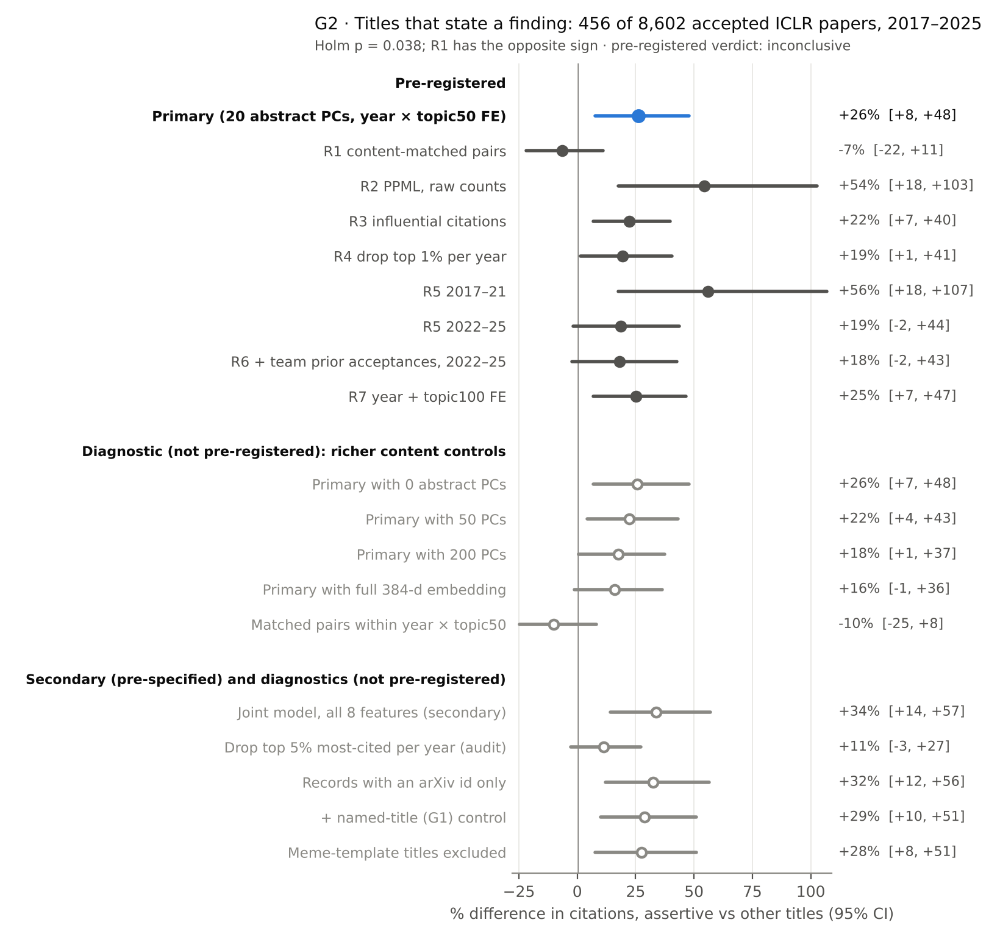

# G2: Titles that state a finding, and citations (accepted ICLR papers, 2017–2025)

Code: `src/cites/g2.py` (run with `cd research/titles/src && OMP_NUM_THREADS=2 /home/user/venv/bin/python -m cites.g2`). Numbers: `results.json`. Figure: `fig.png`.
Pre-registration: `docs/CITES_PREREG.md`. Frozen core: `src/cites/core.py`. Neither was edited.

## Question

Among accepted ICLR papers from 2017–2025 (venue and decision held fixed), do papers whose titles state a finding receive more Semantic Scholar citations than papers with similar content whose titles do not?

- **Exposure.** `G2_assertive` is rule-based. The title contains a verb from the frozen `core.ASSERT` list (is/are/can/do/…, improves, outperforms, enables, matters, needs, solves, guarantees, …) and is not a question.
- **Sample.** 456 of the 8,602 papers (5.3%) are assertive.
- **Outcome.** y = log(1 + citations).

## Primary estimate (pre-registered)

Model: `y ~ G2_assertive + log(team size) + log(abstract words) + 20 abstract-embedding PCs | year × topic50`, with SEs clustered by topic50.

| | % difference in citations | 95% CI | p | Holm p (8 tests) | n (assertive) |
|---|---|---|---|---|---|
| **Primary** | **+26.1%** | **[+7.5, +47.8]** | 0.0063 | **0.038** | 8,574 (456) |

- The estimate and Holm p come from `outputs/cites/primary.json`.
- **Reproduction check:** re-computing with `core.primary` gives the identical coefficient (b = 0.2317, SE 0.0811) and the same n.
- n is 8,574 rather than 8,602 because 28 papers in singleton fixed-effect cells drop out.

## Robustness checks R1–R7 (pre-registered, `core.robustness`)

| ID | Check | % difference | 95% CI | p | n |
|---|---|---|---|---|---|
| R1 | Content-matched pairs (name-masked abstract embedding, cosine ≥ 0.80) | **−6.5%** | [−21.8, +11.1] | — | 454 pairs |
| R2 | PPML on raw counts (sign check) | +54.4% | [+17.6, +102.7] | 0.002 | 8,574 |
| R3 | Influential-citation count | +22.2% | [+6.9, +39.7] | 0.005 | 8,574 |
| R4 | Drop top 1% most-cited per year | +19.4% | [+1.4, +40.6] | 0.039 | 8,481 |
| R5 | 2017–21 | +56.0% | [+17.6, +106.9] | 0.003 | 1,975 |
| R5 | 2022–25 | +18.7% | [−1.8, +43.6] | 0.083 | 6,599 |
| R6 | 2022–25 + team's prior ICLR acceptances | +18.0% | [−2.3, +42.6] | 0.093 | 6,599 |
| R7 | Year + topic100 FE | +25.2% | [+7.0, +46.6] | 0.007 | 8,602 |

## Verdict (pre-registered rule, `core.verdict`)

**Inconclusive.**

- **"More citations" is not met.** The rule needs Holm p < 0.05 and the same sign in R1 and R2.
  - Holm p is 0.038 and R2 has the same sign (+54%).
  - R1, the content-matched pairs, has the opposite sign (−6.5%).
- **"No meaningful difference" is not met.** The primary 95% CI [+7.5, +47.8] does not lie within ±10%.

## Pre-specified secondary analyses (prereg §6; no multiplicity claim)

### Validity of the rule against the claims-pilot LLM title-strength labels

The reference label is `title_strength ≥ 2` (explicit claim) under the claims codebook.

**Overlap with this sample.**
- The claims pilot keyed 500 items: rounds 1–3 plus the 200-item gold sample. 350 of them carry LLM labels: rounds 1–3 and gold block 1.
- 129 keyed items are in this sample, and **91 labelled items** overlap: 26 from round 1, 24 from round 2, 24 from round 3 and 17 from gold block 1.
- Of the 91, the rule marks 37 as assertive and 54 as not.
- The pilot drew items from all submissions 2017–2026, rejected papers included. Only accepted, S2-matched papers from 2017–2025 overlap.
- The pilot's sampling stratum "assertive" equals `G2_assertive` exactly on every overlapping item: it used the same regex. All 91 titles are identical to the text the LLMs saw.

**Item-level consensus** (median title_strength across every label set on the item ≥ 2; each item has 2, 3 or 7 label sets):

| | LLM explicit | LLM not explicit |
|---|---|---|
| Rule: assertive | 31 | 6 |
| Rule: not assertive | 2 | 52 |

- Agreement is 91.2% [83.6, 95.5] and Cohen's κ = 0.81.
- PPV = 0.84 [0.69, 0.92]: when the rule fires, the LLMs agree it is an explicit claim 84% of the time.
- NPV = 0.96 [0.87, 0.99]. Sensitivity is 0.94 and specificity 0.90.
- By annotator, at item level: ChatGPT labels (65 items) give κ = 0.83 and PPV 0.84; Claude C1 labels (91 items) give κ = 0.79 and PPV 0.81.

**Per label set** (label set = annotator × pilot round × codebook version):

| Label set | Model | Codebook | n | rule+/LLM+ | rule+/LLM− | rule−/LLM+ | rule−/LLM− | Agreement | κ | PPV | NPV |
|---|---|---|---|---|---|---|---|---|---|---|---|
| C1 r1 | Claude | v0 | 26 | 10 | 2 | 1 | 13 | 0.88 | 0.77 | 0.83 | 0.93 |
| C2 r1 | Claude | v0 | 26 | 10 | 2 | 1 | 13 | 0.88 | 0.77 | 0.83 | 0.93 |
| C1 r2 | Claude | v1.1 | 24 | 7 | 0 | 0 | 17 | 1.00 | 1.00 | 1.00 | 1.00 |
| C2 r2 | Claude | v1.1 | 24 | 6 | 1 | 0 | 17 | 0.96 | 0.89 | 0.86 | 1.00 |
| G r2 | ChatGPT | v1.1 | 24 | 7 | 0 | 0 | 17 | 1.00 | 1.00 | 1.00 | 1.00 |
| C1 r3 | Claude | v1.2 | 24 | 9 | 1 | 0 | 14 | 0.96 | 0.91 | 0.90 | 1.00 |
| C2 r3 | Claude | v1.2 | 24 | 9 | 1 | 0 | 14 | 0.96 | 0.91 | 0.90 | 1.00 |
| G r3 | ChatGPT | v1.2 | 24 | 9 | 1 | 0 | 14 | 0.96 | 0.91 | 0.90 | 1.00 |
| C1 gold_b1 | Claude | v1.3 | 17 | 4 | 4 | 1 | 8 | 0.71 | 0.40 | 0.50 | 0.89 |
| C2 gold_b1 | Claude | v1.3 | 17 | 5 | 3 | 1 | 8 | 0.76 | 0.52 | 0.62 | 0.89 |
| G gold_b1 | ChatGPT | v1.3 | 17 | 5 | 3 | 1 | 8 | 0.76 | 0.52 | 0.62 | 0.89 |
| C1 gold_b1 | Claude | v1.4 | 17 | 5 | 3 | 1 | 8 | 0.76 | 0.52 | 0.62 | 0.89 |
| C2 gold_b1 | Claude | v1.4 | 17 | 5 | 3 | 1 | 8 | 0.76 | 0.52 | 0.62 | 0.89 |
| HK1 gold_b1 | Claude Haiku | v1.4 | 17 | 5 | 3 | 1 | 8 | 0.76 | 0.52 | 0.62 | 0.89 |
| HK2 gold_b1 | Claude Haiku | v1.4 | 17 | 5 | 3 | 1 | 8 | 0.76 | 0.52 | 0.62 | 0.89 |

Pooled over all 315 item × label-set rows: agreement 0.88, κ = 0.74, PPV 0.77, NPV 0.95.

**Where the rule and the consensus disagree** (8 items):

- **Rule fires, LLMs see no explicit claim (6 items):**
  - The verb is used as a noun or inside a noun phrase: "Weakly Supervised Disentanglement with **Guarantees**", "ProbGAN: Towards Probabilistic GAN with Theoretical **Guarantees**", "Network Pruning That **Matters**", "A Simple but Tough-to-**Beat** Baseline".
  - The claim is hedged: "Why Instruction Finetuning **May Not** Actually **Improve** Context Reliance".
  - The verb is an imperative describing the method: "Dual-mode ASR: Unify and **Improve** Streaming ASR".
- **Rule misses, LLMs see an explicit claim (2 items):**
  - The verb is not on the list: "InstaSHAP: Interpretable Additive Models **Explain** Shapley Values Instantly".
  - The claim is an idiom: "How I Learned to Stop Worrying and Love Retraining".

**Reweighted to this sample's title-form mix** — *diagnostic (not pre-registered)*:
- The overlap over-represents assertive titles (37 of 91 against 456 of 8,602). Reweighting by pilot stratum (assertive / NAME-colon / question / other) gives:
  - specificity 0.99 [0.98, 1.00]
  - PPV 0.84 [0.70, 0.95]
  - **sensitivity 0.51 [0.27, 1.00]**
  - κ = 0.61 [0.35, 0.94]
- CIs come from a stratified bootstrap.
- Read the sensitivity as follows: in the full sample, the rule may miss about half of the titles the LLMs would call explicit claims. The estimated LLM-explicit share is 8.7%, against 5.3% flagged by the rule.
- This rests on only 2 missed items, which stand in for the large "other" and NAME-colon strata, so it is very imprecise.

**Reading.** The rule is a precise but incomplete measure of "the title states a finding".
- About 1 in 6 flagged titles are not explicit claims, mostly noun uses of "guarantee(s)", "matters" or "beat".
- The comparison group may contain a few percent of claim titles the rule misses.
- Misclassification that is unrelated to citations would usually pull the contrast toward zero. Misclassification related to paper type could bias it either way.

### Joint model with all 8 features

G2 in the same model as G1, G3, G4, G5a, G5b, G6a and G6b: **+33.9% [+14.2, +57.0]**, p = 0.0008, n = 8,574.

### Heterogeneity by LLM-topic papers

| Subset | % difference | 95% CI | n (assertive) |
|---|---|---|---|
| LLM-topic papers | +28.9% | [−5.5, +76.0] | 1,879 (135) |
| Other papers | +21.4% | [+1.9, +44.6] | 6,627 (321) |
| Ratio (interaction) | +15.5% | [−21.8, +70.6], p = 0.47 | 8,574 |

There is no evidence that the association differs between LLM-topic and other papers. The subgroup CIs are wide.

## Diagnostics (not pre-registered)

All analyses in this section are **diagnostic (not pre-registered)**. They do not change the primary estimate or the verdict.

### (a) Artefact check: split Semantic Scholar records

**Why it matters.**
- A venue record without an arXiv id can miss citations that S2 attributes to a separate arXiv record.
- In the split-record QC (`outputs/cites/qc_split_records.jsonl`, 30 records, complete at the final run), 7 of 30 checked no-arXiv venue records have a separate S2 record. All 7 separate records have more citations: for example 0 → 20, 12 → 82 and 46 → 599.
- In this sample, 15.6% of records without an arXiv id have zero citations, against 0.7% of records with one.

**Does the artefact differ by G2 status?** No.
- 76.1% of assertive papers' records carry an arXiv id, against 76.9% for other papers.
- By era: 77.1% vs 79.0% in 2017–21 and 75.9% vs 76.2% in 2022–25.
- Adjusted for the primary controls and FE (linear probability model), the difference is −1.2 pp [−5.6, +3.3].
- Zero-citation records in 2022–25: 7.0% of assertive papers vs 5.2% of other papers.

**Primary model re-run on subsets:**

| Diagnostic re-run (primary specification) | % difference | 95% CI | n (assertive) |
|---|---|---|---|
| Records with an arXiv id only | +32.4% | [+12.0, +56.4] | 6,575 (347) |
| Records without an arXiv id only | +18.0% | [−12.4, +59.0] | 1,926 (109) |
| All records, + has-arXiv-id control | +27.7% | [+10.1, +48.2] | 8,574 |
| R1 matched pairs, arXiv-id records only | −1.1% | [−17.4, +20.1] | 345 pairs |

**Result.** The split-record artefact does not create the positive regression estimate, and it does not explain the R1 discrepancy.
- On records whose citation counts are least likely to be split, the regression estimate is larger (+32%).
- R1 stays near zero on those same records (−1%).

### (b) Overlap with named titles (G1) and meme templates (G6a)

**How much the features overlap.**
- 55 of the 456 assertive titles are also named ("NAME: subtitle"), 12.1%, against 25.2% of other titles. Named titles get more citations in the primary analysis for G1.
- 42 of the 83 meme-template titles are also assertive ("… Is All You Need", "… Matters", "… Is Secretly …").

| Diagnostic re-run | % difference | 95% CI | n (assertive) |
|---|---|---|---|
| + G1_name control | +28.9% | [+9.9, +51.1] | 8,574 (456) |
| Named titles excluded | +19.8% | [+1.1, +41.9] | 6,465 (401) |
| + G6a_meme control | +23.6% | [+5.2, +45.2] | 8,574 (456) |
| + G1_name and G6a_meme controls | +26.2% | [+7.4, +48.2] | 8,574 (456) |
| Meme-template titles excluded | +27.5% | [+7.6, +51.1] | 8,491 (414) |
| Titles whose only match is "guarantee(s)" excluded (28) | +27.9% | [+9.2, +49.7] | 8,545 (428) |

**Result.** The regression association is not explained by the overlap with named titles or meme templates. It falls to about +20% among titles without a method name.

### (c) What the rule captures

**Matched words.**
- 52% of the 456 matches are copulas, modals or auxiliaries: is 82, can 60, are 58, do/does/don't 30.
- Next come improve(s) 55, guarantee(s) 28, matter(s) 18, enable(s) 16, solve(s) 14 and need(s) 13.

**15 most-cited assertive titles** (ranked by within-year citation percentile in this sample; raw count shown):

| # | Title | Year | Cites | Pctile | Matched | arXiv id |
|---|---|---|---|---|---|---|
| 1 | Self-Consistency Improves Chain of Thought Reasoning in Language Models | 2023 | 8,013 | 0.999 | improves | yes |
| 2 | Finetuned Language Models are Zero-Shot Learners | 2022 | 5,515 | 0.999 | are | yes |
| 3 | Show-o: One Single Transformer to Unify Multimodal Understanding and Generation | 2025 | 807 | 0.999 | show | yes |
| 4 | Representation Alignment for Generation: Training Diffusion Transformers Is Easier Than You Think | 2025 | 790 | 0.998 | is | yes |
| 5 | iTransformer: Inverted Transformers Are Effective for Time Series Forecasting | 2024 | 2,598 | 0.998 | are | yes |
| 6 | A Time Series is Worth 64 Words: Long-term Forecasting with Transformers | 2023 | 5,012 | 0.998 | is | yes |
| 7 | Scaling LLM Test-Time Compute Optimally Can be More Effective than Scaling Parameters for Reasoning | 2025 | 608 | 0.996 | can | no |
| 8 | Fine-tuning Aligned Language Models Compromises Safety, Even When Users Do Not Intend To! | 2024 | 1,442 | 0.993 | do | yes |
| 9 | Make-A-Video: Text-to-Video Generation without Text-Video Data | 2023 | 2,222 | 0.993 | make | yes |
| 10 | Large Language Models Cannot Self-Correct Reasoning Yet | 2024 | 1,341 | 0.992 | cannot | yes |
| 11 | Least-to-Most Prompting Enables Complex Reasoning in Large Language Models | 2023 | 1,965 | 0.991 | enables | yes |
| 12 | Navigating the Digital World as Humans Do: Universal Visual Grounding for GUI Agents | 2025 | 446 | 0.991 | do | yes |
| 13 | DAB-DETR: Dynamic Anchor Boxes are Better Queries for DETR | 2022 | 1,471 | 0.991 | are | yes |
| 14 | Large Language Models are Human-Level Prompt Engineers | 2023 | 1,654 | 0.990 | are | yes |
| 15 | Train Short, Test Long: Attention with Linear Biases Enables Input Length Extrapolation | 2022 | 1,459 | 0.989 | enables | yes |

**15 least-cited assertive titles:**

| # | Title | Year | Cites | Pctile | Matched | arXiv id |
|---|---|---|---|---|---|---|
| 1 | Wish you were here: Hindsight Goal Selection for long-horizon dexterous manipulation | 2022 | 0 | 0.008 | were | no |
| 2 | Constraining Representations Yields Models That Know What They Don't Know | 2023 | 0 | 0.012 | yields | yes |
| 3 | Offline Reinforcement Learning with Differentiable Function Approximation is Provably Efficient | 2023 | 0 | 0.012 | is | no |
| 4 | CASR: Generating Complex Sequences with Autoregressive Self-Boost Refinement | 2023 | 0 | 0.012 | boost | no |
| 5 | Beyond IID weights: sparse and low-rank deep Neural Networks are also Gaussian Processes | 2024 | 0 | 0.020 | are | no |
| 6 | Context is Environment | 2024 | 0 | 0.020 | is | yes |
| 7 | Lion Secretly Solves a Constrained Optimization: As Lyapunov Predicts | 2024 | 0 | 0.020 | solves | no |
| 8 | Maximum Likelihood Estimation is All You Need for Well-Specified Covariate Shift | 2024 | 0 | 0.020 | is | no |
| 9 | Resonance in Weight Space: Covariate Shift Can Drive Divergence of SGD with Momentum | 2022 | 1 | 0.022 | can | yes |
| 10 | Learning What To Do by Simulating the Past | 2021 | 4 | 0.035 | do | yes |
| 11 | Gradient correlation is a key ingredient to accelerate SGD with momentum | 2025 | 0 | 0.042 | is | no |
| 12 | Time After Time: Deep-Q Effect Estimation for Interventions on When and What to do | 2025 | 0 | 0.042 | do | yes |
| 13 | Sketching for Convex and Nonconvex Regularized Least Squares with Sharp Guarantees | 2025 | 0 | 0.042 | guarantees | yes |
| 14 | Backtracking Improves Generation Safety | 2025 | 0 | 0.042 | improves | no |
| 15 | Multiview Equivariance Improves 3D Correspondence Understanding with Minimal Feature Finetuning | 2025 | 0 | 0.042 | improves | no |

**Reading.**
- **Most of the top list are genuine claim titles.** The rule also fires on method names that contain a listed verb ("Show-o", "Make-A-Video"; the regex treats hyphens as word boundaries) and on non-claim clauses ("… as Humans Do").
- **The bottom list mixes claim titles with clear rule errors.** The errors are "What To Do", "Wish you were here", "Self-Boost" and "with Sharp Guarantees".
- **Several bottom-list zeros look like split-record undercounts rather than real zero citations.** 13 of the 15 records have 0 citations, 8 of them papers from 2022–2024, and 9 of the 15 lack an arXiv id. This is the artefact in (a), and it is not specific to G2.

### (d) Why R1 and the primary estimate disagree

| Diagnostic | % difference | 95% CI | n |
|---|---|---|---|
| R1 with caliper 0.85 | −3.0% | [−20.1, +18.1] | 362 pairs |
| R1 with caliper 0.90 | −16.0% | [−43.2, +20.6] | 86 pairs |
| R1, 2017–21 | +23.4% | [−15.8, +79.4] | 82 pairs |
| R1, 2022–25 | −12.1% | [−27.4, +7.8] | 372 pairs |
| R1 regression-adjusted for pair differences in log team size and log abstract words | −4.3% | [−20.0, +13.3] | 454 pairs |
| Matched pairs within the same year × topic50 cell | −10.2% | [−24.8, +8.1] | 432 pairs |
| Primary model, 0 abstract PCs | +25.6% | [+6.8, +47.8] | 8,574 |
| Primary model, 50 PCs | +22.2% | [+4.3, +43.1] | 8,574 |
| Primary model, 100 PCs | +20.2% | [+2.1, +41.4] | 8,574 |
| Primary model, 200 PCs | +17.6% | [+0.7, +37.4] | 8,574 |
| Primary model, full 384-d abstract embedding | +16.1% | [−1.2, +36.4] | 8,574 |

The R1 pairs are close in content: mean cosine 0.87, and 54% share topic50. They use 430 distinct controls and differ little in team size or abstract length.

**Factors that do not explain the gap.**
- Split records: R1 is −1% on arXiv-id records only.
- Team size or abstract length: the regression-adjusted R1 is −4%.
- Topic fixed effects: matching within year × topic50 gives −10%.
- The caliper: R1 is negative at every caliper tested.

**The content-control dose-response.**
- The first 20 PCs barely move the regression estimate (+26% with 0 PCs, +26% with 20 PCs).
- Richer content controls shrink it steadily: +22% at 50 PCs, +18% at 200 PCs, and +16% with the full embedding, where the CI includes 0.
- Nearest-neighbour matching on the full name-masked embedding gives about zero or a negative difference.

**Interpretation.** This pattern fits the following reading: part of the regression association reflects what kind of paper uses an assertive title, such as empirical findings papers versus method papers, and the 20 PCs do not capture it.
- The estimates do not settle whether all of it does. Even the full-embedding regression is still +16%, and R1 is a noisy estimate (CI −22% to +11%).
- The era split points the same way. R1 is +23% in 2017–21 (82 pairs) but −12% in 2022–25 (372 pairs), where most assertive papers are.

## Interpretation

**Average difference.** Among accepted ICLR papers, papers whose titles state a finding receive on average about 26% more citations than other papers with similar team size, abstract length, abstract content (20 embedding PCs), topic and year (pre-registered regression, Holm p = 0.038).
- PPML, influential citations, dropping outliers and an alternative topic definition all keep the sign.
- The diagnostics indicate that this is not explained by:
  - split S2 records
  - overlap with named titles
  - meme templates
  - noun-phrase matches of "guarantees"

**Against close content matches.** When each assertive paper is compared with its closest content match, there is no detectable difference (−6.5% [−21.8, +11.1]; the CI allows anything from about −22% to +11%). The regression estimate also shrinks as content is controlled more finely.

**Verdict.** The pre-registered rule therefore returns **inconclusive**. The data do not show that a finding-stating title goes with more citations once content is closely matched. They also do not rule out a moderate positive association.

## Caveats

- **Observational.** Authors choose their titles. Papers with an assertive title may differ in kind (findings papers, analysis papers, papers with one clear result) in ways that embeddings capture only partly. Nothing here shows that changing a title would change citations.
- **Measurement.**
  - The rule is precise (PPV about 0.84 against LLM labels) but incomplete. Reweighted to this sample, its sensitivity is about 0.5 with a very wide CI.
  - The validity check rests on 91 overlapping items, and the LLM labels come from several codebook versions (v0–v1.4).
  - The label sets are not independent: 7 of the 15 are repeat labellings of the same 17 gold-block items, and each pilot round used a different codebook version.
  - No human title-strength labels exist for these items.
  - The main claims study (`outputs/claims_main/labels/`) has no labels yet.
- **R1 and the primary use different content representations and estimands.**
  - The primary uses 20 PCs of the unmasked abstract embedding with fixed effects and regression weights.
  - R1 uses an equal-weighted nearest neighbour on the full name-masked embedding (unmasked for 2017).
  - They are not independent tests, and their disagreement is not formally tested.
- **Selection.** Only accepted papers are included. On the reviewer side, title features do not predict acceptance once camera-ready edits are accounted for: 0 of 18 auditable features pass the camera-ready audit (`outputs/SUMMARY.md`). An acceptance audit specific to assertive titles was not run here.
- **Citation data.** Records without an arXiv id carry many implausible zero counts (15.6% vs 0.7%). This adds noise to y, but it is balanced across G2 status.
- **Small exposure group.** With 456 assertive titles, the CIs are wide, and R5, R6 and the subgroup estimates are imprecise.
- **Diagnostics.** The diagnostics in sections (a)–(d) and the reweighted validity were added after the real outcomes were seen. They are not pre-registered and carry no confirmatory weight.

## Advice for authors (observational)

Inconclusive. Among accepted ICLR papers with similar content (the pre-registered regression), papers whose titles state a finding receive about 26% more citations on average (95% CI +8% to +48%). Against closely content-matched papers, however, there is no detectable difference (−7%, 95% CI −22% to +11%), and the association roughly halves once the 5% most-cited papers per year are set aside (diagnostic, see Audit). These data therefore neither show nor rule out a citation advantage for titles that state the finding. They do not support advising authors to make that change for citations. (Corrected in the audit; see below.)

## Audit (adversarial review, 2026-10-17)

### What was checked

- **Reproduction.** `core.primary(core.load(), "G2_assertive")` reproduces `primary.json` exactly: b 0.23169, SE 0.08112, n 8,574, 456 assertive.
  - Holm p 0.0376 is taken from `primary.json`. It is consistent with `core.holm` over the 8 frozen p-values.
- **Verdict.**
  - Holm p < 0.05 and R2 has the same sign, but R1 has the opposite sign (−6.5%). So "more citations" fails.
  - The 95% CI [+7.5, +47.8] is not within ±10%, so "no meaningful difference" also fails.
  - **"Inconclusive" follows the pre-registered rule.**
- **Feature definition.** `G2_assertive` is a `core.ASSERT` match on a non-question title, as frozen in `core.load`. No question title is flagged.
- **Validity analysis (pre-specified secondary).**
  - The pilot keys hold 500 unique submissions, with none duplicated across rounds.
  - The codebook mapping was verified against the pilot files: r1 v0, r2 v1.1, r3 v1.2, gold_b1 v1.3 (including the ChatGPT gold labels, per `chatgpt_gold_b1/PROMPT.md`), and the `v14` files v1.4.
  - The item-level κ was recomputed by hand: 0.815.
  - `claims_main/labels/` is empty; `chatgpt_main/` holds prompts and batches only. The caveat that no main-study title-strength labels exist is correct.
- **Numbers.** Every number in this file was compared with `results.json`, and all match.
- **Frozen files.** The hashes match `prereg_hashes.json`, and `primary.json` is unchanged.

### What was changed

1. **Figure labels (labelling error).** Two figure group headers read "Diagnostic: …" and "Secondary (joint model) and other diagnostics" without saying "not pre-registered".
   - They now read "Diagnostic (not pre-registered): richer content controls" and "Secondary (pre-specified) and diagnostics (not pre-registered)".
   - A row "Drop top 5% most-cited per year (audit)" was added.
2. **Advice sentence (overstated / misdescribed).**
   - The old sentence described the +26% as "among accepted ICLR papers … on average", which drops the fact that the primary already adjusts for content (20 PCs and topic × year FE).
   - It also said assertive titles get "not more than papers with closely matched content". R1's CI (−22% to +11%) does not support that claim.
   - The new sentence states the pre-registered verdict, "inconclusive", and gives both estimates with their CIs.
3. **Wording.**
   - "there is no difference" became "no detectable difference".
   - "not caused by" became "not explained by".
   - The primary's covariates now list the abstract-embedding PCs.
4. **Audit diagnostics added** (below).
   - Code: `src/cites/audit_g1g2.py`, called from `g2.py`.
   - Results: `results.json` → `diagnostics.e_audit_alt_explanations`.
   - `g2.py` was re-run. Every pre-existing value reproduced, up to ~1e-9 in R7's iteratively demeaned two-way FE SE.

### Alternative explanations tested — diagnostic (not pre-registered)

Each re-fit uses the primary controls, year × topic50 FE and SEs clustered by topic50.

| Alternative explanation | Test | Result for G2 |
|---|---|---|
| **Preprint exposure time** | arXiv-id records. Months from first arXiv posting to the conference, entered as FE bins. | Assertive papers are posted 7.1 vs 6.6 months before the conference (adjusted +0.33, p 0.14). G2 is +32.4% on arXiv-id records and **+30.1% [+10.8, +52.8]** with the lead-time FE. |
| **Promotion / code release** | Abstract announces code or a URL. | Assertive 19.7% vs 21.8%. G2 with the indicator: **+27.1% [+8.1, +49.4]**. Within code abstracts −1.0% [−29.1, +38.3] (90 assertive); within others +34.4% [+11.5, +61.9]. |
| **Paper type** (findings vs method paper) | Method and findings abstract indicators. | Assertive abstracts announce a finding more often (56.1% vs 45.8%) and a method less often (58.6% vs 68.1%). G2 with both indicators: **+25.6% [+7.2, +47.1]**. Within findings abstracts +29.7% [+6.7, +57.6]; within method abstracts +24.1% [−0.9, +55.5]. |
| **Superstar outliers** | Within-year citation percentile as the outcome. Drop the top 5% per year. Drop zero-citation records. | Percentile: **+4.2 points [+1.1, +7.2]**, p 0.010. Top 5% dropped: **+11.3% [−2.7, +27.3]**, p 0.13. Zero-citation records dropped: +29.5%. Assertive titles are 9.7% of each year's top 5% (42 papers) and 15.2% of the top 1% (14 papers), against 5.3% overall. |
| **Retitling / reverse causation** | WP4 audit pairs: 568 accepted 2023–25 papers with a pre-decision arXiv v1 title. | Status changed for 14 papers: 6 assertive only at camera-ready, 8 only at v1. On the same papers, the camera-ready exposure gives +37.3% [−26.2, +155.6] and the v1 exposure +1.2% [−44.1, +83.1]. With 36–38 assertive papers this cannot be read either way. |
| **All of the above together** | arXiv-id records; lead-time FE; code, method and findings indicators. | **+30.4% [+10.9, +53.3]** |

**Reading.**
- **Not explained by timing, code, paper type or zero-citation records.** Preprint timing, promotion via code links, being a findings paper rather than a method paper, and zero-citation (split-record) noise do not explain the regression association.
- **The heavy tail matters.**
  - Assertive titles are over-represented among the biggest hits, for example "Self-Consistency Improves…" and "Finetuned Language Models are Zero-Shot Learners".
  - Without each year's top 5% most-cited papers, the estimate drops from +26% to +11% and its CI includes zero.
  - The rank-based outcome still shows a modest shift: +4 percentile points.
- **Combined with the other evidence.** This tail result sits alongside R1's opposite sign and the shrinkage under richer content controls. Together they strengthen the pre-registered "inconclusive": the regression association rests partly on a few very highly cited assertive papers and on coarse content control.
- **Retitling** is rare (14 of 568). The v1-title estimate is too imprecise to say whether claims are added after early attention.

### Confidence in the advice

- **High** that "inconclusive" is the correct pre-registered verdict.
- **Medium** in the corrected advice: the data neither show nor rule out a citation advantage for stating the finding in the title, so they do not support recommending the change for citations.
- The rule-based measure is precise but misses claim titles (reweighted sensitivity about 0.5). The comparison group therefore contains some claim titles, which would bias the contrast toward zero if the misclassification is unrelated to citations.
